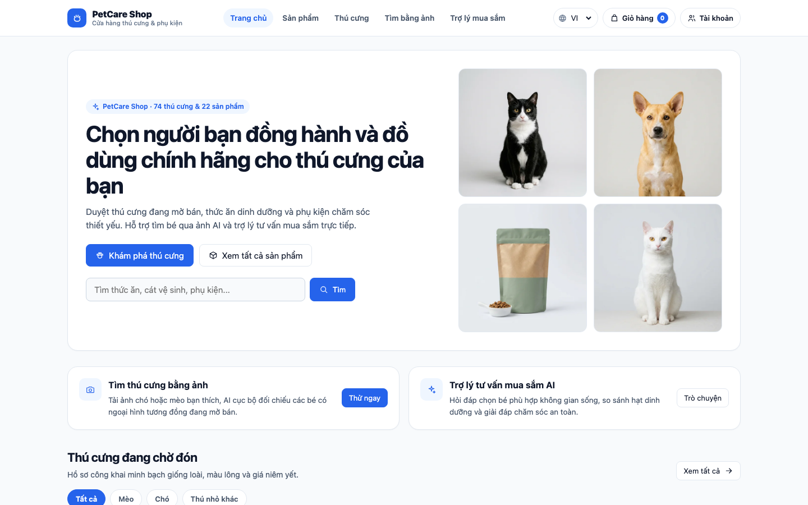
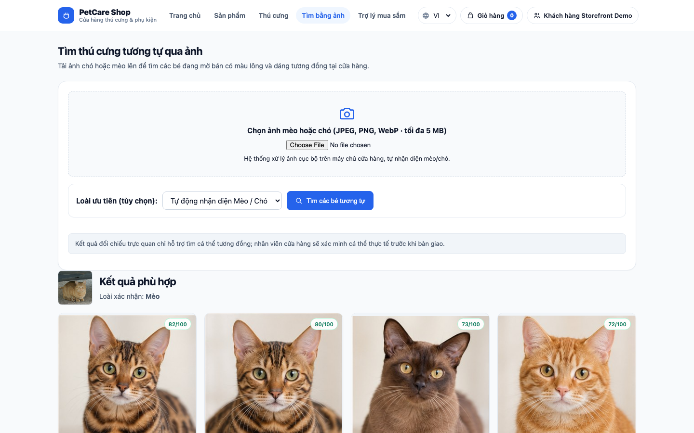
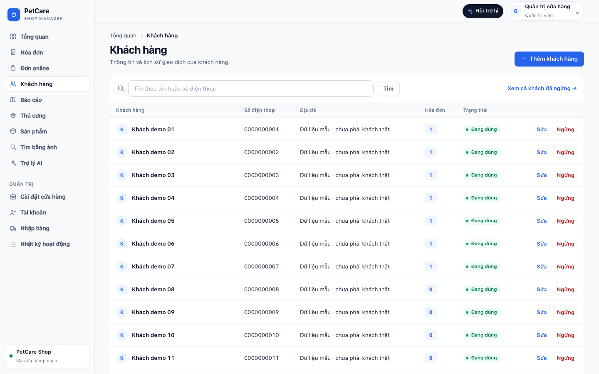
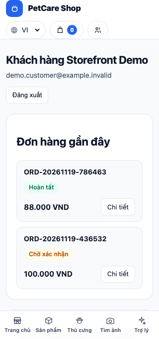

# PetCare Manager

**Multi-Tenant Pet Store Operations, POS Billing, Customer Storefront (`/shop`), Conversational Assistant & Local ONNX AI Vision 4.0** built with **Python + Flask + Jinja2 + Vanilla CSS/JS + MySQL 8.4**.

> **Environment Status**: Verified across local QA and GitHub Actions CI (`6/6` checks) for reproducible demo and controlled staging deployments. Not deployed to public production automatically.

---

## 1. Main Features

- **Store Workspace & POS (`/dashboard`, `/invoices/`, `/customers/`)**: Net paid dashboard KPIs & 8-week demand restock forecast, POS checkout with InnoDB row locking and immutable paid-invoice snapshots, multi-batch purchasing & suppliers (`/purchasing/`), separate refund ledger with restock disposition, multi-store tenant switcher, and read-only audit log (`/activity/`).
- **Customer Storefront (`/shop`)**: Public mobile-first storefront with catalog & pet browsing, real-time stock/reservation awareness (`customer_order_pet_locks`), cart, Store Pickup vs COD checkout, order tracking (`/shop/order-lookup`), customer portal (`/shop/account`), public Shopping AI Assistant (`/shop/ai-assistant`), and public Visual Pet Search (`/shop/image-search`).
- **Online Order Fulfillment (`/orders/`)**: Dedicated staff/admin queue (`pending -> confirmed -> preparing -> ready_completed -> paid/fulfilled` or `rejected/cancelled`).
- **AI Assistant (`/assistant/chat` & Topbar Drawer)**: Deterministic offline Python + MySQL operational/catalog engine with optional opt-in OpenAI/Gemini provider fallback and veterinary safety referrals.
- **Local AI Vision 4.0 ONNX (`/pets/find-similar`, `/shop/image-search`)**: Offline `onnxruntime` species gate + `1280`-D embedding & CIE-Lab similarity retrieval across up to 5 reference photos per pet.
- **Encrypted Backup & Export**: AES-256-GCM `.pcarebackup` backups (`scripts/petcare_backup.py`) and tenant `.pcarexport` bundles (`email-worker` + `export-worker`).

---

## 2. Architecture & Tech Stack

- **Pattern**: Layered Flask monolith with strict route -> service -> repository boundaries (`petcare/app_factory.py` registers **17 Flask Blueprints**; **31 InnoDB tables** across 4 SQL modules with zero ORM).
- **Backend**: Python **3.11 – 3.13** (`Flask 3.1`, `Flask-WTF`, `mysql-connector-python`, `Babel`, `Pillow`, `cryptography`, `XlsxWriter`, `boto3`, `gunicorn`).
- **Database**: **MySQL 8.0.16+** (`InnoDB`, `utf8mb4_unicode_ci`). SQLite is unsupported at runtime.
- **Local Vision Runtime**: `numpy` + `onnxruntime` CPU inference (no PyTorch or outbound network required).
- **Frontend**: Option A Light UI (`petcare/static/css/tokens.css`, `ui.css`, `app.css`, `storefront.css`), vanilla JS, local GSAP `3.15.0` (Node.js `18+` only used for unit/axe test runners; no frontend build step).

See [docs/architecture.md](docs/architecture.md) and [docs/DATABASE_MIGRATIONS.md](docs/DATABASE_MIGRATIONS.md).

---

## 3. Quick Start (Fresh Local Setup & Isolated Demo)

### 3.1 Prerequisites
- Python **3.11+** (`3.11`, `3.12`, `3.13` verified in CI)
- MySQL **8.0.16+** (`InnoDB`, `utf8mb4`)
- Verified ONNX models committed under `petcare/vision/models/`: `yolox_nano.onnx`, `mobilenetv2-12.onnx`, `mobilenetv2-12-features.onnx`

### 3.2 Installation & Environment Configuration
```sh
git clone https://github.com/KhangBon18/petcare-manager.git
cd petcare-manager
python3 -m venv .venv
source .venv/bin/activate          # Windows: .venv\Scripts\Activate.ps1
python -m pip install --upgrade pip
python -m pip install -r requirements.txt -c requirements.lock

cp .env.example .env
# Edit .env: set DB_HOST, DB_PORT, DB_NAME, DB_USER, DB_PASSWORD, SECRET_KEY
```

### 3.3 Database Initialization (Production/Dev Schema)
Create an empty UTF8MB4 database and least-privilege user, then initialize idempotently:
```sql
CREATE DATABASE petcare_shop_dev CHARACTER SET utf8mb4 COLLATE utf8mb4_unicode_ci;
CREATE USER 'petcare_app'@'127.0.0.1' IDENTIFIED BY '<strong-local-password>';
GRANT SELECT, INSERT, UPDATE, DELETE, CREATE, ALTER, INDEX, REFERENCES, DROP ON petcare_shop_dev.* TO 'petcare_app'@'127.0.0.1';
FLUSH PRIVILEGES;
```
```sh
python -m petcare.database.initialize
```

### 3.4 Isolated Demo Setup & Starting Flask
Never seed demo data into real/development databases. Seed only against an isolated `*_test` database:
```sh
D_TMP=$(python -c "import tempfile; print(tempfile.gettempdir())")
mkdir -p "$D_TMP/petcare-demo/pets" "$D_TMP/petcare-demo/prods" "$D_TMP/petcare-demo/exports"

PETCARE_DEMO_MODE=1 APP_ENV=test COOKIE_SECURE=0 \
DB_NAME=petcare_demo_stage_test \
PET_IMAGE_DIR="$D_TMP/petcare-demo/pets" \
PRODUCT_IMAGE_DIR="$D_TMP/petcare-demo/prods" \
TENANT_EXPORT_DIR="$D_TMP/petcare-demo/exports" \
PETCARE_DEMO_ADMIN_PASSWORD='<16+-char-admin-password>' \
PETCARE_DEMO_STAFF_PASSWORD='<16+-char-staff-password>' \
PETCARE_DEMO_CUSTOMER_PASSWORD='<16+-char-customer-password>' \
python scripts/demo_staging_setup.py --reset-disposable --json

PETCARE_DEMO_MODE=1 APP_ENV=test COOKIE_SECURE=0 \
DB_NAME=petcare_demo_stage_test \
PET_IMAGE_DIR="$D_TMP/petcare-demo/pets" \
PRODUCT_IMAGE_DIR="$D_TMP/petcare-demo/prods" \
TENANT_EXPORT_DIR="$D_TMP/petcare-demo/exports" \
python run.py
```
- Internal Workspace (`/login`): `http://127.0.0.1:5055/login` (demo users: `admin`, `staff1`, store slug `main`)
- Customer Storefront (`/shop`): `http://127.0.0.1:5055/shop` (demo customer: `demo.customer@example.invalid`)
- Optional background workers: `python -m petcare.services.tenant_export_worker_cli` and `python -m petcare.services.mail_worker`

### 3.5 Starting with Docker Compose
```sh
docker compose config --quiet
docker compose build
docker compose up -d mysql
docker compose run --rm web python -m petcare.database.initialize
docker compose up -d web email-worker export-worker
```
Health endpoints: `/healthz`, `/readyz`, `/workersz`. Full instructions: [docs/SETUP_GUIDE.md](docs/SETUP_GUIDE.md) and [docs/DEPLOYMENT_GUIDE.md](docs/DEPLOYMENT_GUIDE.md).

---

## 4. Roles, Storefront COD Semantics & AI Modules

- **Admin & Staff Isolation**: Role and tenant membership reload from MySQL per request (`session_version` revokes stale sessions). Staff cannot access `/store/settings`, `/users/`, `/purchasing/`, `/activity/`, or refund creation. See [docs/ADMIN_STAFF_GUIDE.md](docs/ADMIN_STAFF_GUIDE.md).
- **Customer Storefront & COD Payments**: Customer orders start `pending` / `unpaid` with zero online gateway charge. Confirming an order reserves product quantities and acquires `customer_order_pet_locks`. **Cash on Delivery (COD)** / pay-at-store orders remain `unpaid` until staff explicitly confirm payment collection in `/orders/<id>`, which atomically issues a paid invoice and deducts inventory. See [docs/CUSTOMER_STOREFRONT_GUIDE.md](docs/CUSTOMER_STOREFRONT_GUIDE.md).
- **AI Assistant & External Fallback**: Works offline by default (`AI_PROVIDER_APPROVED=0`) via deterministic Python + MySQL queries. Optional external OpenAI/Gemini endpoints (`AI_API_BASE_URL` / `GEMINI_API_KEY`) fall back automatically to local Python on errors/timeouts and visibly label response provenance. See [docs/AI_FEATURES.md](docs/AI_FEATURES.md).
- **AI Vision 4.0 & Honest Identity Boundary**:
  - `yolox_nano.onnx` + `mobilenetv2-12.onnx` + `mobilenetv2-12-features.onnx` verify domestic Cat/Dog uploads locally.
  - Visual similarity scores (`.../100`) assist browsing by appearance and **do NOT verify individual animal biometric identity** (`same_pet_multi_view_reidentification = NOT EVALUATED`). Exact SHA-256 matches only identify identical stored files.
  - **Verified vs Illustrative Photos**: Seeded pet portraits (`assets/demo/pets/`: 68 synthetic portraits) are stored privately and served behind authenticated/public pet photo routes; items without photos render fallback vectors (`petcare/static/img/catalog/fallbacks/*.svg`) visibly badged **"Minh họa" / "Illustrative"**.

---

## 5. Screenshots

| Storefront Desktop (`/shop`) | Customer Visual Search (`/shop/image-search`) |
|---|---|
|  |  |

| Admin Customers & Topbar AI (`1440px`) | Mobile Account Order Cards (`320px`) |
|---|---|
|  |  |

---

## 6. Testing & Security Configuration

```sh
# Syntax + Python unit/web + MySQL integration (on isolated *_test schema)
python -m compileall -q run.py main.py petcare tests
APP_ENV=test DB_HOST=127.0.0.1 DB_PORT=3306 DB_USER=petcare_app DB_PASSWORD="<pw>" \
DB_NAME=petcare_ci_test PETCARE_TEST_DB_NAME=petcare_ci_test \
python -m unittest discover -s tests -q

# JavaScript module tests + Playwright E2E / Axe accessibility
node --test tests/js/*.test.cjs
python scripts/browser_smoke/run_smoke.py

# Security & Dependency checks
bandit -q -r petcare scripts main.py run.py wsgi.py -x petcare/templates,petcare/static -b .security/bandit-baseline.json
pip-audit -r requirements.lock && pip-audit -r requirements-browser.lock
```

Key security defaults: CSRF protection on mutating routes, PBKDF2-HMAC-SHA256 passwords, strict CSP without inline scripts, EXIF-stripped private media (`<= 5 MB`), `COOKIE_SECURE=1` + `DB_SSL_CA` + DML-only runtime MySQL user in production. Never commit `.env` or real credentials. See [SECURITY.md](SECURITY.md) & [docs/TESTING_GUIDE.md](docs/TESTING_GUIDE.md).

---

## 7. Complete Documentation Index

| Area | Document |
|---|---|
| Setup & Install | [docs/SETUP_GUIDE.md](docs/SETUP_GUIDE.md) |
| Architecture & Data Model | [docs/architecture.md](docs/architecture.md), [docs/DATABASE_MIGRATIONS.md](docs/DATABASE_MIGRATIONS.md) |
| User Guides | [docs/user_guide.md](docs/user_guide.md), [docs/ADMIN_STAFF_GUIDE.md](docs/ADMIN_STAFF_GUIDE.md), [docs/CUSTOMER_STOREFRONT_GUIDE.md](docs/CUSTOMER_STOREFRONT_GUIDE.md) |
| AI & Vision 4.0 | [docs/AI_FEATURES.md](docs/AI_FEATURES.md), [docs/AI4_0E_FINAL_VISION_QA.md](docs/AI4_0E_FINAL_VISION_QA.md) |
| Demo & Operations | [docs/DEMO_GUIDE.md](docs/DEMO_GUIDE.md), [docs/DEPLOYMENT_GUIDE.md](docs/DEPLOYMENT_GUIDE.md), [docs/TROUBLESHOOTING.md](docs/TROUBLESHOOTING.md) |
| QA & Security | [docs/TESTING_GUIDE.md](docs/TESTING_GUIDE.md), [SECURITY.md](SECURITY.md), [docs/SECURITY.md](docs/SECURITY.md), [docs/FINAL_UI_MODULE_ACCEPTANCE.md](docs/FINAL_UI_MODULE_ACCEPTANCE.md) |
| Audit & Releases | [docs/REPOSITORY_CLEANUP_AUDIT.md](docs/REPOSITORY_CLEANUP_AUDIT.md), [docs/RELEASE_NOTES.md](docs/RELEASE_NOTES.md), [CHANGELOG.md](CHANGELOG.md), [CONTRIBUTING.md](CONTRIBUTING.md) |

---

## 8. Known Limitations

1. **Visual Search Is Appearance Similarity Only**: Does not verify cross-view individual animal identity.
2. **Offline COD / Counter Payment Only**: No online card/e-wallet gateway; financial confirmation happens manually in `/orders/<id>`.
3. **Self-Service Tenant Signup Off by Default**: `PUBLIC_SIGNUP_ENABLED=0` pending commercial billing and abuse-control policies.
4. **Tablet `834px` Storefront Hero**: Stacks vertically with 2×2 portrait tiles (`1114px` height, `0` overflow).

---

## 9. Clean Release Packaging (`git archive`)

Build reproducible release ZIPs directly from the verified `main` commit (never from a dirty local working tree):
```sh
git archive --format=zip --prefix=petcare-manager/ -o ../PetCare-Manager-<version>.zip main
(cd .. && shasum -a 256 PetCare-Manager-<version>.zip > PetCare-Manager-<version>.sha256)
(cd .. && shasum -a 256 -c PetCare-Manager-<version>.sha256)
```
