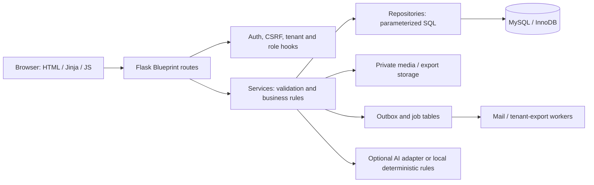

# Petcare Manager — kiến trúc Python

## Sơ đồ luồng request

## Thành phần

| Lớp | Vị trí | Trách nhiệm |
|---|---|---|
| Application factory/config | `petcare/app_factory.py`, `app_configuration.py`, `config.py` | Tạo Flask app, load config, kiểm tra cấu hình, đăng ký hooks và blueprints. |
| Routes | `petcare/routes/` | Nhận HTTP/form/JSON, yêu cầu login, parse request và ánh xạ service result thành response/redirect. |
| Services | `petcare/services/` | Validation nghiệp vụ, permission checks, transaction boundaries, orchestration và error translation. |
| Repositories | `petcare/repositories/` | SQL truy vấn và persistence; tenant filter lấy từ scoped DB session variable khi dùng tenant context. |
| Database | `petcare/database/` | MySQL connection, schema initialization/migrations, readiness, seed, backup/export logic. |
| Templates/static | `petcare/templates/`, `petcare/static/` | Server-rendered Jinja page và JS enhancements; forms vẫn có HTTP path. |
| Vision | `petcare/vision/`, `petcare/services/pet_image_service.py` | Private image storage, local descriptor/similarity, optional provider suggestions. |
| Background | `petcare/services/*worker*` | Mail outbox, tenant export and heartbeat lifecycle. |

## Blueprints và đường dẫn chính

- `auth_routes`: `/login`, `/signup`, logout.
- `main_routes`: `/`, `/dashboard`.
- `customer_routes`: `/customers/`, create/edit/detail.
- `pet_routes`: `/pets/`, `/pets/find-similar`, `/pets/suggest-attributes`, pet media.
- `product_routes`: `/products/`, stock adjustment and image endpoints.
- `invoice_routes`: `/invoices/`, `/invoices/new`, lookups, pay/cancel/refund.
- `purchasing_routes`: `/purchasing/`, suppliers, order create/detail/receive/cancel.
- `report_routes`: `/reports/`, report export.
- `assistant_routes`: `POST /assistant/chat`.
- `user_routes`: `/users/`, invitation, tenant export jobs/download.
- `account_routes`, `store_routes`, `audit_routes`: account settings/security, tenant configuration and activity.
- `health_routes`: `/healthz`, `/readyz`, `/workersz`; `metrics_routes` is separately token/permission protected.

Contract details and payload examples are in [API_CONTRACT.md](API_CONTRACT.md).

## Request, authentication and isolation

Flask request hooks load the signed session and membership context. `login_required` checks authentication; route/service permission checks distinguish `owner`, `admin`, and `staff`. Tenant ID is derived from membership/session, not accepted from a client parameter as authority. Repositories scope tenant data with tenant ID and/or `@petcare_tenant_id`; composite foreign keys bind child rows to records in the same tenant. CSRF protects state-changing browser forms.

## Validation and errors

Routes accept browser forms or JSON, services normalize/validate domain input, and raise service-level errors for expected invalid state. Route handlers translate these into field feedback, flash/redirect, or JSON status codes. Database constraints provide a final consistency boundary. Unknown errors are handled centrally and logged without exposing credentials. User-visible labels are localized VI/EN.

## Transactions and workers

Inventory-critical services lock invoice/product/pet or purchase rows, validate current state, mutate stock/status and write ledger rows within the same transaction. Purchase receiving uses a request fingerprint/key to reject duplicate retries. Refunds append immutable refund/refund-item records; paid invoice facts stay intact. Export and mail requests are persisted, then workers claim and process jobs and publish heartbeats; `/workersz` is healthy only when expected workers report fresh heartbeats.

## AI boundary

Assistant intent handling can return deterministic/local responses and report-backed insights from tenant MySQL. Optional LLM calls use a provider adapter and narrowed context. The local Vision mock in `scripts/demo/vision_mock.py` emits a fixed synthetic JSON response; it is not image understanding and provides no model-quality evidence. See [AI evaluation](PHASE55_AI_EVALUATION.md) and [limitations](FINAL_KNOWN_LIMITATIONS.md).
