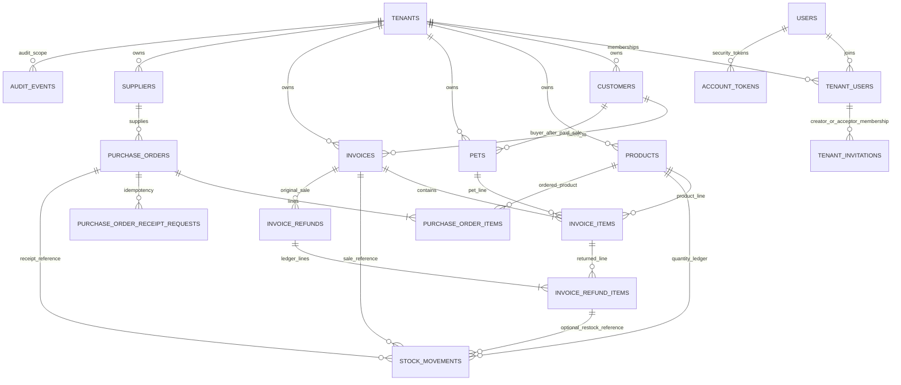

# Petcare Manager — database ERD

This ERD summarizes the current MySQL 8/InnoDB schema from `petcare/database/schema.sql`, `purchasing.sql`, `refunds.sql` and additive initialization logic. It is a logical view, not a replacement for `SHOW CREATE TABLE`.

## Major entity groups

- **Identity/tenancy:** `tenants`, global `users`, tenant membership `tenant_users`; invitation and owner-transfer records; `account_tokens` for account security.
- **Store catalog:** `customers`, `products`, `pets`; `pet_photo_lsh` stores derived locality-sensitive buckets, not source images.
- **Sales:** `invoices`, immutable price/name snapshots in `invoice_items`, `stock_movements`, `invoice_refunds`, `invoice_refund_items`.
- **Purchasing:** `suppliers`, `purchase_orders`, `purchase_order_items`, `purchase_order_receipt_requests`.
- **Operations:** `schema_migrations`, `email_outbox`, `tenant_export_jobs`, `worker_heartbeats`, `audit_events`, `login_throttle`, `request_throttle`.

## Tenant boundaries

Business tables carry `tenant_id`; composite unique indexes and foreign keys pair tenant with child/reference IDs. For example, an invoice line references an invoice and its product/pet inside the same tenant. The authenticated membership establishes tenant scope. Global identity/security queues are intentionally not ordinary store-owned catalog rows.

## Important data rules

- `invoice_items` permits either product or pet per row; pet quantity is exactly one.
- Purchase item received quantity cannot exceed ordered quantity; receipt ledger rows increase stock only for accepted quantities.
- A paid pet sale assigns `pets.buyer_id` and `sold_at`; unpaid/cancelled invoices must not change stock or ownership.
- Refund ledgers do not rewrite the original invoice. Returned product disposition decides whether stock is restocked.
- `stock_movements` is the auditable quantity delta ledger; current product stock is stored separately and checked against lifecycle operations.

## Migrations and verification

`initialize_database()` applies the base schema idempotently and then compatibility/additive adjustments. The migration markers currently represented in code include UTC datetime conversion, purchasing, invoice refunds and purchase receipt idempotency. MySQL DDL auto-commits, so schema changes require preflight, verified backup and restore rehearsal. Current Phase 6.2 schema was initialized only on disposable QA. See [database remediation](DB_READINESS_REMEDIATION.md) for the development database boundary.
