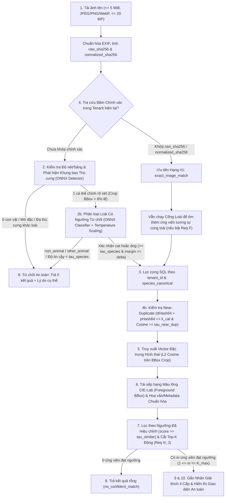

# Kiến trúc Kỹ thuật Đề xuất cho AI-4.0 — High-Precision Pet Image Matching (`docs/AI4_MATCHING_ARCHITECTURE.md`)

Tài liệu này thiết kế kiến trúc **Python-first, chạy cục bộ 100% offline, không tốn phí API và không gửi ảnh khách hàng ra ngoài** cho phân hệ tìm kiếm và đối chiếu ảnh thú cưng **AI-4.0**, giải quyết triệt để các khuyết tật của baseline histogram/SimHash đã chỉ ra trong [AI4_VISION_AUDIT.md](AI4_VISION_AUDIT.md).

---

## 1. Ánh xạ 10 Yêu cầu Nghiệp vụ (`Requirements A–J`) vào Ràng buộc Thiết kế

| Mã yêu cầu | Quy tắc hành vi bắt buộc | Cơ chế bảo chứng trong kiến trúc AI-4.0 |
| :---: | :--- | :--- |
| **Req A** | Tải ảnh mèo -> **chỉ trả về mèo** | Cổng phân loại loài có ngưỡng tin cậy $\tau_{\text{species}}$ + lọc cứng SQL `species_canonical = 'cat'`. Nếu không chắc chắn loài -> trả rỗng, không quét chéo sang chó. |
| **Req B** | Tải ảnh chó -> **chỉ trả về chó** | Cổng phân loại loài + lọc cứng SQL `species_canonical = 'dog'`. |
| **Req C** | Ảnh tải lên đã tồn tại trong cửa hàng -> **ưu tiên hồ sơ đó ở vị trí đầu** | Tầng đối sánh mã băm kép `raw_sha256` (byte gốc) và `normalized_sha256` (ảnh chuẩn hóa) chạy độc lập **trước** bước chấm điểm metadata -> luôn đạt Hạng `#1` (`exact_image_match`), triệt tiêu lỗi tụt hạng `8/68` của baseline cũ. |
| **Req D** | Nhận diện ảnh gần trùng (`near-duplicate`) khi bằng chứng đủ mạnh | Kết hợp khoảng cách Hamming trên `dHash64` + `pHash64` $\le k_{\text{cal}}$ **VÀ** độ tương đồng cosine vector đặc trưng vùng thú cưng $\ge \tau_{\text{near\_dup}}$ trên cùng loài. |
| **Req E** | Ảnh chụp khác của cùng con vật -> **không khẳng định danh tính cá thể** nếu thiếu xác thực tin cậy | Không bao giờ gắn nhãn xác nhận cá thể cho ảnh khác góc chụp khi cửa hàng chỉ lưu ảnh tham chiếu thông thường; chỉ xếp vào mức `visually_similar_candidate` kèm khuyến nghị nhân viên kiểm tra trực tiếp. |
| **Req F** | Không có ảnh trùng khớp -> tùy chọn gợi ý thú cưng cùng loài có ngoại hình tương tự | Nhánh truy xuất vector đặc trưng + tái xếp hạng màu lông/hoa văn trong tập ứng viên cùng loài vượt ngưỡng $\tau_{\text{similar}}$ (có thể bật/tắt trên giao diện). |
| **Req G** | Ảnh mèo cam -> **ưu tiên các bé mèo cam tương đồng**, không gợi ý mèo khác màu không liên quan | Trích xuất phân bố màu `CIE-Lab` (`L*a*b*`) **chỉ bên trong khung bao (bounding box) con mèo** để tách nền phòng/studio, kết hợp vector đặc trưng hình thái và nhãn màu chuẩn hóa. |
| **Req H** | Độ tương đồng hoặc độ tin cậy thấp -> **trả về danh sách rỗng (`0` kết quả)** | Loại bỏ ngưỡng sàn `0.12` quá thấp; áp dụng từ chối hai tầng: (1) từ chối ngay khi không thấy thú cưng / mờ nặng / đa loài / độ tự tin loài thấp; (2) từ chối mọi ứng viên có điểm $< \tau_{\text{similar}}$. |
| **Req I** | Tuyệt đối không gắn nhãn các con vật chỉ giống nhau là "cùng một cá thể" | Chuẩn hóa 4 cấp nhãn kết quả tường minh trong API & giao diện (`exact_image_match`, `near_duplicate_image`, `visually_similar_candidate`, `no_confident_match`). |
| **Req J** | Không nhồi nhét thú cưng không liên quan chỉ để lấp đầy danh sách Top-K | Cắt danh sách động theo ngưỡng $\tau_{\text{similar}}$: trả về đúng $m \in [0, K_{\max}]$ hồ sơ đạt chuẩn (nếu chỉ có `1` hoặc `2` mèo cam phù hợp thì chỉ hiển thị đúng `1` hoặc `2` kết quả). |

---

## 2. Luồng Kiến trúc 10 Giai đoạn (10-Stage Python-First Matching Pipeline)

### Chi tiết từng giai đoạn kỹ thuật

1. **Giai đoạn 1 — Kiểm tra An toàn Tệp Tải lên & Chuẩn hóa (`petcare/vision/image_features.py`)**:
   - Giữ nguyên các chốt chặn bảo mật đã kiểm chứng (`<= 5 MiB`, kiểm tra magic bytes `JPEG/PNG/WebP` qua Pillow, `<= 20 MP`, gỡ EXIF).
   - Tính `raw_sha256` trên luồng byte gốc trước khi nén lại và `normalized_sha256` trên ảnh RGB chuẩn hóa `<= 1600 px` để nhận diện cả tệp gốc lẫn tệp tải về từ cửa hàng.
   - Bổ sung kiểm tra chất lượng ảnh đầu vào cơ bản bằng `numpy`: phương sai toán tử biên độ sáng (Laplacian variance) để phát hiện ảnh mờ nhòe hoàn toàn và kiểm tra tỷ lệ điểm ảnh cháy sáng/tối đặc (`> 92%` pixel $< 12$ hoặc $> 248$).
2. **Giai đoạn 2 — Phát hiện Khung bao Thú cưng & Phân loại Loài Có Từ chối (`Species & Subject Gate`)**:
   - **Phát hiện chủ thể (`Detector`)**: Dùng mô hình phát hiện vật thể siêu nhẹ chạy qua `onnxruntime` (ví dụ `SSDLite320-MobileNetV3-Large` chuẩn COCO, lớp `15: cat`, `16: dog`, `14: bird`, `17..23: động vật khác`, `0: person`):
     - Nếu không có khung bao động vật nào vượt ngưỡng phát hiện $\tau_{\text{det}}$ và điểm phân loại toàn ảnh rơi vào nhóm đồ vật/văn bản -> **từ chối ngay (`reason = "no_pet_detected"`)**.
     - Nếu phát hiện $\ge 2$ khung bao thú cưng có diện tích đáng kể (đặc biệt khi vừa có `cat` vừa có `dog` trong một ảnh) -> **từ chối/yêu cầu chụp tách riêng từng cá thể (`reason = "multiple_pets_detected"`)** để không trộn lẫn đặc trưng.
     - Nếu có `1` chủ thể chính: cắt vùng khung bao thú cưng kèm lề `8%` (`pet_crop`) để **loại bỏ nhiễu gối xanh, thảm len hay bàn ghế phía sau** (khắc phục trực tiếp lỗi nền trên ảnh `miu-orange-cream.png`).
   - **Phân loại loài có hiệu chỉnh xác suất (`Calibrated Species Classifier`)**: Đưa `pet_crop` qua mạng phân loại/nhúng đặc trưng ONNX, tính xác suất đã hiệu chỉnh nhiệt độ $T$:
     $$
     p = \text{softmax}(z / T), \quad p_{\text{cat}}, p_{\text{dog}}, p_{\text{other}}, p_{\text{non\_pet}}
     $$
     Chỉ chấp nhận loài $s^* \in \{\text{cat}, \text{dog}\}$ khi đồng thời thỏa mãn:
     $$
     p_{s^*} \ge \tau_{\text{species}} \quad \text{và} \quad |p_{\text{cat}} - p_{\text{dog}}| \ge \delta_{\text{margin}}
     $$
     Nếu không đạt cả hai điều kiện -> trả trạng thái `species_abstained` và **không trả về danh sách thú cưng phỏng đoán**.
3. **Giai đoạn 3 — Chuẩn hóa Cột Loài & Lọc Cứng Phía Máy chủ (`Hard Species Filtering`)**:
   - Bổ sung hàm chuẩn hóa tất định `canonicalize_species(raw_text) -> 'cat' | 'dog' | 'other'` (và cột sinh/chỉ mục `species_canonical` trong bảng `pets`) để gom mọi biến thể `"Mèo"`, `"mèo con"`, `"cat"`, `"kitten"`, `"feline"` về `'cat'` và `"Chó"`, `"chó con"`, `"dog"`, `"puppy"`, `"canine"` về `'dog'`.
   - Truy vấn SQL trong `pet_repo.py` bắt buộc gắn mệnh đề cứng `AND p.species_canonical = %s` (`'cat'` hoặc `'dog'`). Khi cổng loài trả `'cat'`, ứng viên `'dog'`, `'Thỏ'`, `'Hamster'` có **xác suất bằng `0` tuyệt đối** xuất hiện trong tập ứng viên.
4. **Giai đoạn 4 — Đối sánh Ảnh Trùng khớp Chính xác & Gần trùng (`Exact & Near-Duplicate Gate`)**:
   - **Exact Duplicate (`O(1)` qua chỉ mục MySQL `(tenant_id, raw_sha256)` và `(tenant_id, normalized_sha256)`)**: Nếu trùng mã băm trong cùng `tenant_id`, hồ sơ đó được ghim cố định ở đỉnh kết quả với nhãn `exact_image_match` (tách riêng cảnh báo nếu cá thể đó đã ở trạng thái `sold` hoặc `inactive`).
   - **Near-Duplicate (`dHash64` + `pHash64` + Embedding)**: Tính mã băm gradient `64`-bit (`dHash64`) và mã băm tần số cosin rời rạc `64`-bit (`pHash64`). Một ứng viên cùng loài chỉ được gắn nhãn `near_duplicate_image` khi khoảng cách Hamming $\le k_{\text{cal}}$ **đồng thời** độ tương đồng cosine của vector đặc trưng sâu $\ge \tau_{\text{near\_dup}}$ (xử lý ảnh bị nén lại qua Zalo/Messenger, đổi kích thước hoặc cắt viền nhẹ).
5. **Giai đoạn 5 — Truy xuất Vector Đặc trưng Thị giác Tinh (`Visual Embedding Retrieval`)**:
   - Từ `pet_crop` (`224 x 224`), mạng backbone ONNX trích xuất vector đặc trưng chuẩn hóa độ dài đơn vị $\mathbf{e} \in \mathbb{R}^d$ ($\|\mathbf{e}\|_2 = 1$, lưu dưới dạng mảng `float16` nén base64/nhị phân gọn nhẹ `~0.8–1.5 KB`/ảnh).
   - Với quy mô cửa hàng thông thường (`<= 5.000` thú cưng đang bán), phép nhân ma trận `numpy` `candidates_matrix @ query_vec` trên `5.000` vector `512`–`960` chiều chỉ mất **`< 1.5 ms`** trên CPU mà đạt độ chính xác `100%` exact nearest neighbors. Với quy mô lớn hơn `5.000`, giữ cơ chế SimHash LSH 8-band nhưng tính trên **SimHash của chính vector đặc trưng sâu $\mathbf{e}$** thay vì histogram màu thô.
6. **Giai đoạn 6 — Tái xếp hạng Màu lông `CIE-Lab` Vùng Chủ thể & Thuộc tính Đã Xác minh (`Foreground Color & Trait Reranking`)**:
   - Giải quyết triệt để **Requirement G (`mèo cam -> ưu tiên mèo cam`)**:
     - Trên vùng trung tâm bên trong khung bao `pet_crop` (đã loại nền), chuyển điểm ảnh sang không gian màu cảm nhận đều **`CIE-Lab` (`L*`, `a*` đỏ–lục, `b*` vàng–lam)**, vốn tách biệt độ sáng chiếu sáng (`L*`) khỏi sắc độ lông thật (`a*, b*`) tốt hơn nhiều so với RGB ngưỡng cứng.
     - Tính độ tương đồng phân bố màu lông $S_{\text{coat}} \in [0, 1]$ (giao histogram `CIE-Lab` chuẩn hóa) và điểm khớp từ khóa màu chuẩn hóa song ngữ (`orange/ginger/cam/vàng kem` thuộc cùng nhóm lân cận ấm, tách biệt hoàn toàn với `black/đen`, `gray/xám xanh`, `white/trắng`).
   - Công thức điểm cho nhóm `visually_similar_candidate` (chỉ áp dụng sau khi đã qua lọc cứng cùng loài, và **không bao giờ** ghi đè tầng `exact_image_match` / `near_duplicate_image`):
     $$
     S_{\text{sim}}(q, c) = w_{\text{emb}} \cdot \cos(\mathbf{e}_q, \mathbf{e}_c) + w_{\text{coat}} \cdot S_{\text{coat}}(q, c) + w_{\text{meta}} \cdot S_{\text{trait}}(q, c), \quad w_{\text{emb}} + w_{\text{coat}} + w_{\text{meta}} = 1
     $$
     trong đó các trọng số $(w_{\text{emb}}, w_{\text{coat}}, w_{\text{meta}})$ được xác định thực nghiệm trên tập `calibration` (`w_emb` giữ vai trò chủ đạo để bảo toàn hình thái khuôn mặt/độ dài lông/kiểu tai).
7. **Giai đoạn 7 & 8 — Ngưỡng Hiệu chỉnh & Xử lý Không có Kết quả (`Calibrated Thresholds & Abstention`)**:
   - Không dùng hằng số cảm tính `0.12`. Ba ngưỡng quyết định ($\tau_{\text{species}}, \tau_{\text{near\_dup}}, \tau_{\text{similar}}$) được khóa từ quy trình hiệu chỉnh trên tập `calibration` (xem chi tiết tại [AI4_ACCEPTANCE_CRITERIA.md](AI4_ACCEPTANCE_CRITERIA.md)).
   - Mọi ứng viên có $S_{\text{sim}}(q, c) < \tau_{\text{similar}}$ bị loại bỏ hoàn toàn. Nếu không còn ứng viên nào -> trả `results = []`, `match_outcome = "no_confident_match"` kèm thông báo rõ ràng thay vì cố điền đủ `12` thẻ.
8. **Giai đoạn 9 — Hệ thống Nhãn Giải thích 4 Cấp Trung thực (`Explainable Result Labels`)**:
   - Mỗi kết quả trả về mang trường `match_tier` bắt buộc thuộc một trong các giá trị sau:
     1. `exact_image_match`: *"Trùng khớp chính xác tệp ảnh hồ sơ trong cửa hàng"*.
     2. `near_duplicate_image`: *"Ảnh gần trùng khớp cao với ảnh hồ sơ đã lưu (cùng bố cục/khung hình)"*.
     3. `visually_similar_candidate`: *"Cá thể cùng loài có ngoại hình tương tự đang bán · Không khẳng định là cùng một con vật — vui lòng đối chiếu hồ sơ chi tiết"*.
   - Khi không có kết quả: `no_confident_match` kèm mã lý do (`no_pet_detected`, `multiple_pets_detected`, `low_image_quality`, `species_uncertain`, `unsupported_species`, `below_similarity_threshold`).
9. **Giai đoạn 10 — Tích hợp Giao diện & CSDL An toàn, Tương thích Ngược (`Safe UI & Schema Integration`)**:
   - **Migration cộng dồn không phá vỡ dữ liệu cũ**: Bổ sung các cột nullable/mặc định an toàn trên `pets` (hoặc bảng phụ `pet_photo_signatures` gắn khóa ngoại `ON DELETE CASCADE` theo `(tenant_id, pet_id)`): `species_canonical`, `raw_sha256`, `normalized_sha256`, `perceptual_hashes_json`, `embedding_version`, `embedding_blob`. Giữ nguyên `photo_descriptor` cũ trong giai đoạn chuyển tiếp và nâng cấp công cụ dòng lệnh `python -m petcare.vision.reindex_pet_descriptors --apply` để tính toán lại cho toàn bộ ảnh hiện có mà không sửa tệp ảnh gốc.
   - **Tích hợp UI (`pets/search_image.html`)**: Tách riêng khối **"Hồ sơ khớp ảnh trực tiếp"** (nếu có `exact_image_match` / `near_duplicate_image`) khỏi khối tùy chọn **"Các thú cưng cùng loài có ngoại hình tương tự"** (có checkbox bật/tắt theo **Requirement F**); bỏ thanh phần trăm gây hiểu lầm là "xác suất nhận diện danh tính", thay bằng huy hiệu `match_tier` và các lý do cụ thể (*"Cùng loài: Mèo · Tương đồng sắc lông cam vằn & hình thái lông ngắn"*).

---

## 3. So sánh Các Phương án Mô hình Thị giác Cục bộ, Chi phí Tài nguyên & Bản quyền

Kiểm tra trực tiếp phần cứng máy phát triển hiện tại ghi nhận: **Apple M1 Pro (`arm64`, 10 nhân CPU, `16.0 GB` RAM, Python `3.13`, `Pillow 13.0.0`)** và môi trường CI là **GitHub Actions Ubuntu `x86_64` (2 vCPU, `7 GB` RAM, không có GPU)**.

| Tiêu chí so sánh | Phương án 0: Baseline hiện tại (`Pillow` HSV + Grid + SimHash) | **Phương án 1 (Khuyến nghị Chính): `ONNX Runtime` + `SSDLite-MobileNetV3` + `MobileNetV3-Large` / `DINOv2-ViT-S/14` INT8 + `CIE-Lab`** | Phương án 2 (Thay thế Ngữ nghĩa Cao): `ONNX Runtime` + `OpenCLIP ViT-B/32` Vision INT8 (kèm vector nhãn tĩnh) | Phương án 3 (Không khuyến nghị cho Web Runtime): Cài trực tiếp `PyTorch` + `torchvision` / `timm` |
| :--- | :--- | :--- | :--- | :--- |
| **Thư viện Python cần thêm** | `0` (chỉ `Pillow`) | **`onnxruntime` + `numpy`** (`2` wheel phổ biến, ổn định cao) | **`onnxruntime` + `numpy`** | `torch`, `torchvision`, `sympy`, `networkx`... |
| **Dung lượng thư viện cài thêm** | `0 MB` | **`~24–30 MB`** tổng cộng | **`~24–30 MB`** tổng cộng | `~250–450 MB` (làm chậm Docker build & CI rõ rệt) |
| **Dung lượng tệp trọng số (`.onnx`)** | `0 MB` | **`~15 MB`** (`MobileNetV3` combo INT8) hoặc **`~28 MB`** (nếu dùng `DINOv2-S/14` INT8 cho embedding) | `~88 MB` (`ViT-B/32` Vision INT8 + `20 KB` text prototypes) | `~15–90 MB` |
| **RAM tăng thêm khi chạy Web** | `< 15 MB` | **`~90–180 MB` RSS** (rất nhẹ trên máy 16 GB & CI 7 GB) | `~220–340 MB` RSS | `~450–800 MB` RSS |
| **Độ trễ suy luận 1 ảnh (CPU)** | `~2 ms` | **`~12–35 ms` trên M1 Pro** / `~35–90 ms` trên CI 2-vCPU | `~25–50 ms` trên M1 Pro / `~70–130 ms` trên CI | `~20–60 ms` (nhưng khởi động tiến trình nặng) |
| **Tương thích macOS `arm64` & Linux CI** | Gốc | **Wheel dựng sẵn chính thức** cho cả `macosx_11_0_arm64` và `manylinux_x86_64` | Wheel dựng sẵn chính thức cho cả hai nền tảng | Có wheel nhưng kích thước quá lớn cho container ứng dụng quản lý |
| **Phát hiện nhiều thú cưng & Cắt bỏ nền** | Không có | **Có** (nhờ tầng Detector khung bao `SSDLite-MobileNetV3` COCO) | Yếu hơn nếu không ghép thêm Detector khung bao | Có nếu cài kèm Detector |
| **Chặn chéo loài Mèo <-> Chó & Đồ vật** | **Thất bại** (`85.3%` lẫn loài Top-5) | **Rất mạnh** (kết hợp lớp `cat`/`dog` của Detector + Classifier hiệu chỉnh xác suất) | **Rất mạnh** (đối chiếu cosine với vector prompt tĩnh) | Mạnh |
| **Giấy phép Mã nguồn Mở (License)** | Nội bộ dự án | **`MIT` (`onnxruntime`), `BSD-3-Clause` (`numpy`, `torchvision` MobileNetV3/SSDLite), `Apache-2.0` (`DINOv2`)** — 100% tự do học thuật & thương mại | **`MIT` (`OpenCLIP` datacomp/laion weights)** — *(Lưu ý: tránh `MobileCLIP` của Apple do giấy phép AMLR hạn chế hơn)* | `BSD-3-Clause` |

### Kết luận Lựa chọn Công nghệ cho AI-4.0
- **Chọn Phương án 1 (`onnxruntime` + `numpy` + `Pillow`) làm kiến trúc chuẩn**:
  1. Dùng **`SSDLite320-MobileNetV3-Large` (BSD-3-Clause, xuất tĩnh `.onnx` INT8/FP16)** làm cổng phát hiện khung bao động vật, đếm số lượng cá thể và cắt bỏ phông nền.
  2. Dùng **`MobileNetV3-Large` (BSD-3-Clause)** hoặc **`DINOv2-ViT-S/14` INT8 (Apache-2.0)** kèm đầu phân loại tuyến tính đã hiệu chỉnh nhiệt độ (`cat` / `dog` / `other_animal` / `non_animal`) làm bộ trích xuất vector đặc trưng hình thái tinh + cổng phân loại loài nghiêm ngặt.
  3. Kết hợp tầng băm `SHA-256` + `dHash64/pHash64` và bộ mô tả màu lông `CIE-Lab` trên vùng khung bao đã cắt nền.
- **Không tải trọng số tự động từ Internet trong lúc chạy ứng dụng hoặc chạy CI**: Tệp `.onnx` đã kiểm định mã băm `SHA-256` sẽ được đóng gói cố định theo kho mã nguồn (hoặc script tải một lần có khóa `SHA-256` dành riêng cho bước build offline được duyệt), đảm bảo ứng dụng vận hành **100% offline, tất định và không phụ thuộc dịch vụ đám mây**.
