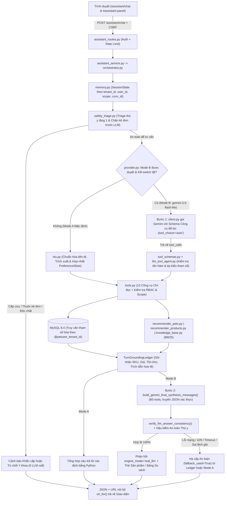

# Kiến trúc PetCare AI Giải thích Chuyên sâu (`petcare/ai/`)

Tài liệu này giải thích chi tiết cách **PetCare AI** được thiết kế và hiện thực hóa trong gói Python `petcare/ai/` (tích hợp trực tiếp với `petcare/services/assistant_service.py` và `petcare/routes/assistant_routes.py`), đảm bảo mọi thông tin kỹ thuật khớp chính xác với mã nguồn tại mốc phát hành `fe2f54facf7aab477ec919d54c9b570ff4703d1c`.

---

## 1. Triết lý Kiến trúc: Python Kiểm soát Nghiệp vụ, LLM Chỉ Điều phối & Diễn đạt

Khác với cách tiếp cận đưa toàn bộ cơ sở dữ liệu hoặc cho phép mô hình ngôn ngữ lớn (LLM) tự viết câu lệnh SQL, **PetCare AI** áp dụng kiến trúc **"Python-First Grounded Tool-Calling"**:

1. **Hai chế độ vận hành tách biệt rõ ràng**:
   - **Mode A — Offline Deterministic Python (`EngineMode.OFFLINE`, mặc định toàn hệ thống)**: Toàn bộ phân tích câu hỏi (`nlu.py`), xếp hạng gợi ý, quy đổi đơn giá, tra cứu tri thức BM25 và định dạng câu trả lời chạy 100% nội bộ bằng Python + MySQL, không phát sinh bất kỳ kết nối mạng bên ngoài nào (`AI_PROVIDER_APPROVED = False`, `AI_TOOL_CALLING_ENABLED = False`).
   - **Mode B — Approved Real LLM Tool-Calling (`EngineMode.REAL_LLM`, bật có kiểm soát trong QA)**: Khi quản trị viên chủ động phê duyệt trong phiên QA (`AI_PROVIDER=gemini`, `AI_MODEL=gemini-3.5-flash-lite`, `AI_PROVIDER_APPROVED=True`, `AI_TOOL_CALLING_ENABLED=True`), mô hình Google Gemini Free Tier đóng vai trò hiểu câu hỏi tự nhiên, chọn công cụ Python được phép và tổng hợp câu trả lời tiếng Việt/tiếng Anh từ kết quả JSON đã xác thực.
2. **Bốn nguyên tắc bất biến dù chạy Mode A hay Mode B**:
   - LLM **không bao giờ** sinh SQL hoặc truy cập trực tiếp MySQL.
   - Mọi phép lọc tồn kho, loại trừ dị ứng, quy đổi đơn giá `Decimal` và kiểm tra quyền (`tenant_id`, `role`, `scope`) đều do Python thực thi phía máy chủ.
   - Chốt chặn cấp cứu thú y thực thi bằng Python **trước khi** gọi mạng ra LLM (`0` API request tiêu tốn cho các tình huống nguy kịch).
   - Mọi số tiền, mã SKU và trạng thái tồn kho trong văn bản do LLM sinh ra đều bị hậu kiểm đối chiếu với sổ cái đối chứng `TurnGroundingLedger` trước khi trả về trình duyệt.

---

## 2. Sơ đồ Kiến trúc Luồng Xử lý Hội thoại (Mermaid Architecture Diagram)

---

## 3. Phân tích Ngôn ngữ Tự nhiên bằng Python (`petcare/ai/nlu.py`)

Ngay cả khi không có LLM ngoài, `petcare/ai/nlu.py` xử lý trọn vẹn câu hỏi song ngữ Việt–Anh thông qua chuỗi bước xác định:

1. **Chống Prompt Injection & Ranh giới Chỉ-đọc**:
   - Phát hiện các mẫu tấn công vượt quyền (`ignore previous instructions`, `reveal api key`, `tiet lo system prompt`, `mat khau database`...) để từ chối an toàn, đồng thời vẫn cho phép các câu truy vấn thống kê cửa hàng hợp lệ không đọc lịch sử hội thoại.
   - Chặn mọi ý định ghi dữ liệu (*tạo hóa đơn, sửa tồn kho, hoàn tiền, đặt đơn nhập*) và hướng dẫn người dùng sang đúng màn hình giao dịch có xác nhận của con người.
2. **Chuẩn hóa Tiền tệ Khẩu ngữ Tiếng Việt & Tiếng Anh**:
   - Chuyển đổi chính xác chữ số và tiếng lóng tiền tệ tiếng Việt (`"4 xị"` -> `400k`, `"3 xị rưỡi"` -> `350k`, `"5 củ rưỡi"` -> `5.5 triệu`, `"200 cành"` -> `200k`, `"400k quay đầu / đổ lại"` -> trần ngân sách `<= 400.000 VND`, `"từ 3 triệu trở lên"` -> sàn ngân sách `>= 3.000.000 VND`) bằng kiểu `Decimal`.
3. **Trích xuất Ràng buộc & Định tuyến Đa Ý định Giới hạn (`<= 2` công cụ)**:
   - Nhận diện loài (`cat`/`dog`), độ tuổi (`junior`/`adult`), không gian sống (`apartment`/`house`), cân nặng (`pet_weight_kg`), tính cách mong muốn, danh mục sản phẩm (`food`, `litter`, `toy`, `care`, `accessory` — bao gồm các cụm tự nhiên như *"gợi ý hạt"*, *"chọn hạt"*, *"mua hạt"*) và dị ứng thành phần (`chicken`, `salmon`, `beef`, `grain`, `soy` kể cả khi mô tả qua triệu chứng như *"ăn thịt gà bị ngứa nổi mẩn"*).
   - Hỗ trợ câu hỏi ghép 2 nhu cầu trong cùng một lượt (ví dụ: *"Cách chuyển đổi thức ăn mới cho mèo trong 7–10 ngày và gợi ý hạt dưới 400k?"* -> chạy đồng thời `search_pet_care_knowledge` + `recommend_products`).

---

## 4. Thuật toán Chấm điểm Gợi ý & Quy đổi Đơn giá (`recommender_pets.py`, `recommender_products.py`)

### 4.1. Ghép đôi Thú cưng 2 Giai đoạn — Chính sách Không Định kiến Giống (`recommender_pets.py`)
- **Giai đoạn 1 (Lọc cứng)**: Chỉ giữ các cá thể thuộc `tenant_id` hiện tại có `sale_status = 'available'`, đúng loài (`cat`/`dog`), đúng giới tính (nếu yêu cầu) và nằm trong khoảng `[budget_min, budget_max]`.
- **Giai đoạn 2 (Chấm điểm giải thích `0..100`)**:
  $$
  S_{\text{pet}} = S_{\text{budget}}\;(0..30) + S_{\text{space}}\;(0..25) + S_{\text{temperament}}\;(0..25) + S_{\text{completeness}}\;(0..20)
  $$
  - **Không suy đoán từ tên giống**: Hệ thống chỉ cộng điểm không gian/tính cách dựa trên `weight_kg` và `appearance_tags` đã được cửa hàng ghi nhận thực tế trong DB. Nếu trường dữ liệu trống (`status="unknown"`), hệ thống cộng `0` điểm thưởng và gắn nhãn cảnh báo *"Chưa ghi nhận"* thay vì tự bịa đặc điểm theo giống loài.
  - Phá hòa tất định theo `(-score, sale_price, id)`, trả tối đa `5` hồ sơ tốt nhất.

### 4.2. Gợi ý & So sánh Sản phẩm Chuẩn hóa Đơn giá `Decimal` (`recommender_products.py`)
- **Chuẩn hóa quy cách đóng gói (`parse_package_unit`)**: Phân tích khối lượng/thể tích/số lượng từ tên & mô tả (`1.5kg`, `85g`, `10L`, `250ml`, `80 tờ`) bằng `Decimal` để quy đổi về cùng mặt bằng so sánh:
  - Khối lượng: hiển thị `VND/kg` hoặc `VND/100g` (ví dụ `FOOD-001` `100.000 VND / 1kg = 100.000 VND/kg`; `FOOD-004` `210.000 VND / 1.5kg = 140.000 VND/kg`; `FOOD-003` `15.000 VND / 85g = 17.647 VND/100g`).
  - Thể tích & số lượng: quy đổi `VND/L`, `VND/100ml`, `VND/tờ`.
- **Loại trừ Dị ứng & Xử lý Hết hàng Trung thực**:
  - Khi phiên hội thoại ghi nhận `allergies=("chicken",)`, mọi sản phẩm có thành phần gà (`FOOD-002`, `FOOD-005`) bị loại cứng khỏi kết quả.
  - Mặt hàng `stock_qty == 0` bị loại khỏi danh sách mua ngay; nếu không có sản phẩm chính nào còn hàng khớp bộ lọc, hệ thống đặt `no_primary_match = True` và gợi ý tối đa `3` sản phẩm cùng loài/ngân sách còn hàng với nhãn rõ ràng `[Thay thế]` / `[Alternative]`.
- **Công thức xếp hạng sản phẩm (`0..100` điểm)**:
  $$
  S_{\text{prod}} = S_{\text{species}}\;(0..30) + S_{\text{category}}\;(0..25) + S_{\text{stage\_weight}}\;(0..15) + S_{\text{budget\_unit}}\;(0..20) + S_{\text{stock}}\;(0..10)
  $$

---

## 5. Đối chứng Dữ liệu MySQL (`TurnGroundingLedger` & `verify_llm_answer_consistency`)

Mỗi lượt gọi công cụ trong `petcare/ai/llm_tool_agent.py` đều ghi dữ liệu gốc từ MySQL vào `TurnGroundingLedger`:
- Danh sách mã SKU/thú cưng được phép nhắc tới (`allowed_codes`), tên chuẩn, giá bán chính xác (`_format_price_for_llm` chuẩn hóa `Decimal('100000.0000')` thành `"100000"` và `"100.000 VND"`), trạng thái tồn kho và bộ lọc đã áp dụng (`applied_filters`).
- Sau khi LLM sinh văn bản trả lời, hàm `verify_llm_answer_consistency()` kiểm tra:
  1. Không xuất hiện mã SKU hoặc mã thú cưng lạ không nằm trong tập kết quả công cụ của lượt hiện tại.
  2. Không xuất hiện con số giá tiền mâu thuẫn với giá niêm yết thực tế trong MySQL.
  3. Không chèn liên kết ngoài trái phép và không vi phạm ranh giới y khoa thú y.
- Nếu bất kỳ kiểm tra nào thất bại, văn bản của LLM bị loại bỏ ngay lập tức và thay bằng bản tổng hợp xác định từ `TurnGroundingLedger`.

---

## 6. Giao thức Gọi Hàm 2 Bước với Google Gemini Free Tier (`client.py`, `llm_tool_agent.py`)

Khi tích hợp `gemini-3.5-flash-lite` qua endpoint tương thích OpenAI `https://generativelanguage.googleapis.com/v1beta/openai/`, hệ thống giải quyết triệt để các khác biệt đặc thù của Gemini bằng giao thức 2 bước chặt chẽ:

1. **Bước 1 — Chọn Công cụ Được Cấp quyền (`tool_choice="auto"`)**:
   - Hàm `sanitize_tool_schema_for_gemini()` trong `tool_schemas.py` tự động lược bỏ các từ khóa JSON Schema mà tầng dịch OpenAPI 3.0 của Gemini từ chối (`additionalProperties`, `pattern`, `minLength`, `maxLength`, `uniqueItems`, và bỏ `parameters` rỗng ở hàm không đối số `get_operations_overview`), trong khi trình kiểm tra Python `validate_and_build_tool_kwargs()` vẫn giữ nguyên toàn bộ các ràng buộc chặt đó ở phía máy chủ.
   - Không gửi tham số `reasoning_effort="none"` (vốn chỉ dành cho dòng GPT-6) và cấp ngân sách `max_tokens = 1536` đủ cho cả token suy luận nội bộ (`thought_signature`) lẫn câu trả lời tiếng Việt.
   - Bảo toàn nguyên vẹn `extra_content.google.thought_signature` và `tool_call.id` trong thông điệp phản hồi.
2. **Thực thi Công cụ tại Máy chủ Python**:
   - Chỉ thực thi tối đa `AI_MAX_TOTAL_TOOL_CALLS` (`4`) công cụ nằm trong `TOOL_REGISTRY`, áp đặt khóa cách ly `ActorContext(tenant_id, user_id, role, scope)`.
3. **Bước 2 — Tổng hợp Câu trả lời Không Kèm Công cụ (`build_gemini_final_synthesis_messages()`)**:
   - Thực nghiệm kiểm thử cho thấy tầng `/v1beta/openai/` của Gemini đôi khi vẫn phát sinh thêm `tool_calls` nếu mảng `tools` còn xuất hiện trong request thứ hai dù đã đặt `tool_choice="none"`.
   - Do đó, ở bước tổng hợp cuối cùng (`AI_MAX_TOOL_ROUNDS=2`), `build_gemini_final_synthesis_messages()` đóng gói kết quả Python đã xác minh thành khối `VERIFIED_PYTHON_TOOL_RESULTS_JSON` trong chuỗi vai trò chuẩn `system -> user -> assistant -> user` và **loại bỏ hoàn toàn cả hai trường `"tools"` lẫn `"tool_choice"`** khỏi payload HTTP. Nhờ đó Gemini luôn trả về câu tư vấn tự nhiên (`finish_reason="stop"`) ổn định trong đúng `2` lượt gọi API.

---

## 7. Truy xuất Tri thức Chăm sóc (`Okapi BM25`) & An toàn Thú y (`knowledge_base.py`, `safety_triage.py`)

### 7.1. Kho Tri thức 9 Tài liệu Chuẩn & Công thức Okapi BM25
Kho `KNOWLEDGE_CORPUS` gồm đúng **9 tài liệu song ngữ đã biên tập** (`KB-NUTR-001` dinh dưỡng WSAVA, `KB-SAFE-002` độc chất ASPCA, `KB-GROOM-003` vệ sinh lông/răng AVMA, `KB-ENV-004` căn hộ & khay cát $N+1$ AAFP/ISFM, `KB-ENR-005` vận động Cornell/ASPCA, `KB-BEH-006` hành vi AVMA, `KB-OWN-007` nhận nuôi có trách nhiệm AVMA, `KB-PROD-008` chọn sản phẩm WSAVA, `KB-VET-009` dấu hiệu cấp cứu AVMA).

Bộ truy xuất `BM25KnowledgeRetriever` đánh chỉ mục unigram + bigram chuẩn hóa không dấu với $k_1 = 1.5$, $b = 0.75$, nhân hệ số $2\times$ cho từ khóa chuyên ngành, điều chỉnh theo loài ($1.15\times$ cùng loài, $0.65\times$ khác loài) và yêu cầu ngưỡng điểm tối thiểu $\text{MIN\_BM25\_SCORE} = 2.2$:

$$
\text{BM25}(Q, D) = \sum_{i=1}^{m} \ln\left(1 + \frac{N - n(q_i) + 0.5}{n(q_i) + 0.5}\right) \cdot \frac{f(q_i, D)\cdot (k_1 + 1)}{f(q_i, D) + k_1 \cdot \left(1 - b + b \cdot \frac{|D|}{\text{avgdl}}\right)}
$$

### 7.2. Phòng thủ Chiều sâu 3 Tầng về An toàn Thú y
- **Tầng 1 — Cấp cứu Khẩn cấp (`severity="emergency"`)**: `evaluate_veterinary_safety()` bắt ngay các dấu hiệu nguy kịch (khó thở/há miệng thở gấp ở mèo, bí tiểu/rặn tiểu, co giật, nôn ra máu, chướng bụng cứng, ăn nhầm hoa ly, sô-cô-la, xylitol, nho khô, thuốc người Paracetamol/Ibuprofen, bả chuột, nhỏ nhầm Permethrin của chó lên mèo), có xét phủ định theo mệnh đề (*"không khó thở"*, *"năm ngoái từng bị nhưng đã khỏi"*) để tránh báo động giả. Khi kích hoạt, hệ thống ngắt ngay luồng mua sắm và hiển thị cảnh báo đỏ `role="alert"`.
- **Tầng 2 — Chặn Chẩn đoán & Liều thuốc (`severity="medical_boundary"`)**: Từ chối kê kháng sinh, phác đồ điều trị hoặc tính liều `mg/kg`.
- **Tầng 3 — Miễn trừ Trách nhiệm & Giới hạn Loài (`severity="disclaimer"`)**: Luôn gắn thẻ trích dẫn `https://` và lời nhắc tham khảo bác sĩ thú y; từ chối lịch sự câu hỏi chăm sóc thú ngoại lai ngoài chó/mèo.

---

## 8. Bộ nhớ Hội thoại, Phân quyền RBAC & Cơ chế Hạ cấp An toàn (Fallback)

### 8.1. Bộ nhớ Phiên Cô lập 4 Chiều (`petcare/ai/memory.py`)
- Khóa phiên: `(tenant_id, user_id, scope, conversation_id)`, thời gian sống mặc định `1800 giây` (30 phút), tối đa `512` phiên LRU trong bộ nhớ tiến trình và lưu tối đa `8` lượt tóm tắt gần nhất.
- Trước khi lưu vào bộ nhớ hoặc ghi báo cáo kiểm thử, `redact_sensitive_text()` và bộ lọc bí mật trong `client.py` tự động che email, số điện thoại, chuỗi thẻ và mọi khóa `AIza...` / `sk-...` / `Bearer`.

### 8.2. Ma trận Phân quyền `13` Công cụ Chỉ-đọc (`petcare/ai/tools.py`)

| Nhóm công cụ | Tên công cụ chính xác trong `TOOL_REGISTRY` | Phạm vi (`scope`) | Vai trò (`role`) | Giới hạn dòng |
| :--- | :--- | :---: | :---: | :---: |
| **Tư vấn Khách mua & Cửa hàng (`8` công cụ)** | `search_products`, `get_product_details`, `compare_products`, `search_available_pets`, `get_pet_public_details`, `recommend_pets`, `recommend_products`, `search_pet_care_knowledge` | `shopper_preview`, `workspace` | `any` (`admin`, `staff`) | `1–12` |
| **Nghiệp vụ Nội bộ Nhân viên & Quản trị (`2` công cụ)** | `get_restock_insights`, `get_sales_summary` | Chỉ `workspace` | `any` (`admin`, `staff`) | `5–8` |
| **Nghiệp vụ Quản trị Cấp cao (`3` công cụ)** | `get_purchase_status`, `get_inventory_forecast`, `get_operations_overview` | Chỉ `workspace` | Chỉ `admin` (`owner`/`admin`) | `8–15` |

- `ActorContext` được dựng hoàn toàn từ phiên đăng nhập phía server; nếu LLM cố gọi `get_sales_summary` trong `shopper_preview` hoặc nhân viên `staff1` cố gọi `get_purchase_status`, `execute_tool()` ném `ToolPermissionError` ngay tại tầng Python.

### 8.3. Bộ Giới hạn Tần suất Free Tier & Hạ cấp An toàn (`provider.py`, `client.py`)
- `FreeTierRateLimiter` kiểm soát cửa sổ trượt `10 RPM / 180.000 TPM / 450 RPD` kèm khoảng nghỉ tối thiểu `1200 ms` giữa 2 request để luôn nằm dưới trần Google AI Studio Free Tier (`~15 RPM / 250.000 TPM / 500 RPD`).
- Khi mất mạng, hết hạn chờ (`timeout`), gặp mã `HTTP 429`, bật công tắc ngắt khẩn cấp `AI_PILOT_KILL_SWITCH=1` hoặc không vượt qua hậu kiểm đối chiếu giá, hệ thống **không bao giờ tự chuyển sang model trả phí** mà lập tức hạ cấp về kết quả đã xác minh trong `TurnGroundingLedger` hoặc **Mode A Offline Python** (`fallback_used=True`), cập nhật huy hiệu giao diện sang `offline_fallback_active` để người dùng luôn nhận được câu trả lời chính xác từ MySQL.
