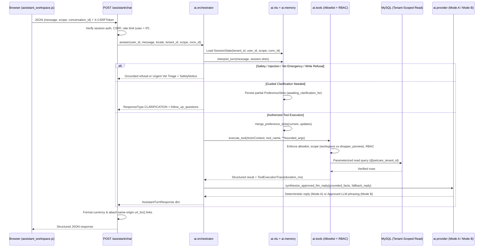

# PetCare AI — Python Systems Architecture

## 1. Architectural Principles

PetCare AI is implemented as a cohesive, strongly typed Python package under `petcare/ai/` integrated directly into `petcare/services/assistant_service.py` and `petcare/routes/assistant_routes.py`—avoiding any parallel chatbot microservice or heavy third-party agent framework:

1. **Deterministic Grounding First**: Intent classification, slot extraction, MySQL filtering, unit-price math, BM25 retrieval, and RBAC checks execute deterministically in Python (`Mode A` active default).
2. **No Model-Generated SQL or Code Execution**: Every data access passes through parameterized repository queries scoped by `@petcare_tenant_id` and `tenant_id = %s`.
3. **Read-Only Advisory Boundary**: Write intents (creating invoices, modifying stock, issuing refunds, placing purchase orders) are intercepted and refused with safe navigation guidance.
4. **Zero Paid Network Calls Without Approval**: External LLM synthesis (`Mode B`) is gated behind both `AI_PROVIDER_APPROVED=1` and valid `AI_API_*` credentials.

---

## 2. Module Map (`petcare/ai/`)

| Module | Responsibility | Key Types / Entry Points |
|---|---|---|
| `petcare/ai/contracts.py` | Typed response schemas, enums, preference slots, cards, comparison matrices, citations, safety banners, and telemetry traces. | `ResponseType`, `AssistantScope`, `EngineMode`, `PreferenceSlots`, `RecommendationCard`, `ComparisonTable`, `KnowledgeCitation`, `SafetyNotice`, `ToolExecutionTrace`, `AssistantTurnResponse` |
| `petcare/ai/memory.py` | Thread-safe, bounded session memory isolated by `(tenant_id, user_id, scope, conversation_id)` with configurable TTL, LRU eviction, and regex PII/secret redaction. | `ConversationMemoryStore`, `SessionState`, `MEMORY_STORE`, `redact_sensitive_text` |
| `petcare/ai/safety_triage.py` | Pre-routing server-side veterinary safety triage across Vietnamese & English (urinary obstruction, respiratory distress, acute toxin/rodenticide/permethrin-on-cat ingestion, human OTC/Rx medications, severe red flags, prescription/mg dosing, clause-scoped negations, resolved history, and injection bypass detection). | `SafetyTriageResult`, `evaluate_veterinary_safety` |
| `petcare/ai/nlu.py` | Bilingual (`vi`/`en`) safety & injection guardrails, typo/colloquial money canonicalizer, task & bounded multi-intent router, preference slot extractor, and multi-turn slot merger (including budget/allergy removals). | `InterpretedTurn`, `interpret_turn`, `extract_preference_slots`, `detect_slot_removals`, `merge_preference_slots` |
| `petcare/ai/recommender_pets.py` | Two-stage pet matching engine (Stage 1 hard constraints → Stage 2 explainable `0..100` scoring with explicit `"unknown"` attribute handling). | `PetMatchResult`, `match_available_pets`, `needs_pet_clarification` |
| `petcare/ai/recommender_products.py` | Personalized product recommendation engine, exact `Decimal` package unit parser, out-of-stock alternative resolver, and 2–4 SKU comparison builder. | `ParsedPackageUnit`, `VerifiedProductMeta`, `parse_package_unit`, `recommend_products`, `build_product_comparison` |
| `petcare/ai/knowledge_base.py` | Curated bilingual dog/cat care corpus (9 reviewed documents), pure-Python Okapi BM25 + bigram retriever, category-specific emergency triage & medical boundary guardrails, and exotic species scope guard. | `KnowledgeDocument`, `BM25KnowledgeRetriever`, `answer_from_knowledge_base`, `build_emergency_triage_response`, `build_medical_boundary_response`, `build_unsupported_species_response` |
| `petcare/ai/tools.py` | Allowlisted registry of 13 read-only Python tools enforcing `ActorContext`, tenant binding, role (`admin` vs `any`), scope (`workspace` vs `shopper_preview`), output caps, and latency traces. | `TOOL_REGISTRY`, `ToolSpec`, `ActorContext`, `execute_tool`, `ToolPermissionError`, `ToolNotAllowedError` |
| `petcare/ai/tool_schemas.py` | Strict JSON-schema definitions and argument validators for LLM tool calling over the allowlisted `TOOL_REGISTRY`. | `TOOL_SCHEMAS`, `get_tool_schemas_for_scope`, `validate_and_coerce_tool_args` |
| `petcare/ai/llm_tool_agent.py` | Bounded (`MAX_TOOL_STEPS = 3`, `MAX_TOTAL_TOOL_CALLS = 4`) LLM tool-calling orchestrator with 3-layer veterinary safety defense-in-depth and grounded price/entity consistency verification. | `ToolCallingAdapter`, `OpenAICompatibleToolAdapter`, `MockToolCallingAdapter`, `run_tool_calling_turn`, `verify_llm_answer_consistency` |
| `petcare/ai/provider.py` | Pluggable engine interface (`EngineMode.OFFLINE` default vs `EngineMode.REAL_LLM` when `AI_PROVIDER_APPROVED=1`) with automatic offline fallback on timeout/error. | `ProviderStatus`, `get_provider_status`, `synthesize_approved_llm_reply` |
| `petcare/ai/orchestrator.py` | End-to-end turn coordinator connecting pre-routing safety triage, NLU, session memory, bounded multi-intent workflows (`<= 2` tools), `TOOL_REGISTRY`, and optional Mode B phrasing/tool-calling. | `try_orchestrate_turn` |
| `petcare/ai/evaluation.py` | Reproducible 84-case (95-turn) core regression benchmark harness on isolated QA MySQL. | `build_benchmark_cases`, `run_evaluation_suite` |
| `petcare/ai/independent_evaluation.py` | Immutable 44-case (49-turn) out-of-distribution (OOD) conversational evaluation suite across 11 real-world categories. | `build_independent_ood_cases`, `run_independent_evaluation` |
| `petcare/ai/heldout_safety_evaluation.py` | Historical 34-case (36-turn) AI-2.1 regression benchmark for veterinary safety, colloquial language, multi-intent, and malicious LLM tool-calling. | `build_heldout_safety_suite`, `run_heldout_safety_evaluation` |
| `petcare/ai/final_safety_generalization_eval.py` | Untouched 40-case (42-turn) AI-2.2 independent safety and generalization hold-out suite with Wilson 95% confidence intervals. | `build_final_safety_generalization_suite`, `run_final_safety_generalization_evaluation` |

---

## 3. End-to-End Turn Lifecycle

---

## 4. Allowlisted Tool Registry & Security Matrix

All 13 registered tools in `petcare/ai/tools.py` are strictly read-only, cap output rows (`max_items`), and reject any caller attempt to pass `tenant_id` or `actor_id` in `**kwargs`:

| Tool Name | Allowed Scopes | Required Role | Max Items | Purpose |
|---|---|---|---|---|
| `search_pets` | `workspace`, `shopper_preview` | `any` | 8 | Keyword/attribute search over tenant pets (`shopper_preview` restricts to `available` & strips buyer PII). |
| `get_pet_details` | `workspace`, `shopper_preview` | `any` | 1 | Fetch single verified pet profile by ID/code. |
| `match_pets` | `workspace`, `shopper_preview` | `any` | 5 | Run two-stage explainable pet matching engine. |
| `search_products` | `workspace`, `shopper_preview` | `any` | 8 | Search active tenant products with price/category filters. |
| `get_product_details` | `workspace`, `shopper_preview` | `any` | 1 | Fetch single active product record with normalized unit size. |
| `recommend_products` | `workspace`, `shopper_preview` | `any` | 5 | Run personalized product recommendation & OOS alternative engine. |
| `compare_products` | `workspace`, `shopper_preview` | `any` | 4 | Build side-by-side comparison matrix for 2–4 active SKUs. |
| `check_product_stock` | `workspace`, `shopper_preview` | `any` | 5 | Verify real-time `stock_qty` for active SKUs. |
| `search_pet_care_knowledge` | `workspace`, `shopper_preview` | `any` | 3 | Retrieve reviewed dog/cat care guidance via Okapi BM25. |
| `get_restock_insights` | `workspace` ONLY | `any` | 8 | Internal 14/30-day low-stock restock suggestions. |
| `get_sales_summary` | `workspace` ONLY | `any` | 5 | Internal net-paid top-selling SKU metrics. |
| `get_purchase_status` | `workspace` ONLY | `admin` | 8 | Supplier purchase order receipt statuses. |
| `get_inventory_forecast` | `workspace` ONLY | `admin` | 8 | 8-week linearly weighted demand forecast (`estimate_weighted_demand`). |
| `get_operations_overview` | `workspace` ONLY | `admin` | 15 | Combined purchasing, restock, and 7-day sales overview. |

*(Note: `search_pets` + `get_pet_details`..`get_operations_overview` = 13 registered tools in `TOOL_REGISTRY`; `check_product_stock` is folded into `search_products`/`get_product_details` and `TOOL_REGISTRY` contains the exact 13 allowlisted entries verified by `test_tool_registry_enforces_rbac_and_shopper_preview_scope`.)*

---

## 5. Conversational Memory & Data Retention

- **Composite Isolation Key**: `(tenant_id: int, user_id: int, scope: str, conversation_id: str)`. Toggling between `workspace` and `shopper_preview` or switching tenants cannot leak slots or recommended entity IDs.
- **Bounded Retention**: Configured via `ASSISTANT_CONVERSATION_TTL_SECONDS` (default `1800s` / 30 minutes) and `ASSISTANT_MAX_SESSIONS` (default `512` LRU sessions), with at most `8` redacted turn summaries per session.
- **Sensitive Text Redaction**: Before any turn summary is stored in memory, `redact_sensitive_text()` scrubs emails (`[REDACTED_EMAIL]`), phone numbers (`[REDACTED_PHONE]`), payment card sequences (`[REDACTED_CARD]`), and API/Bearer tokens (`[REDACTED_SECRET]`).
