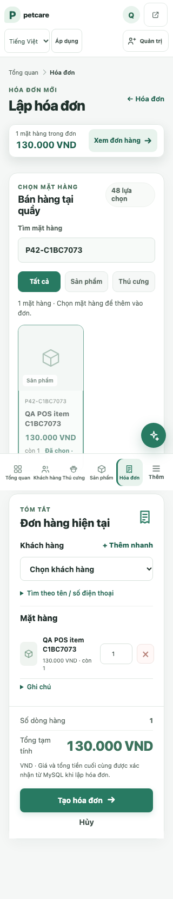
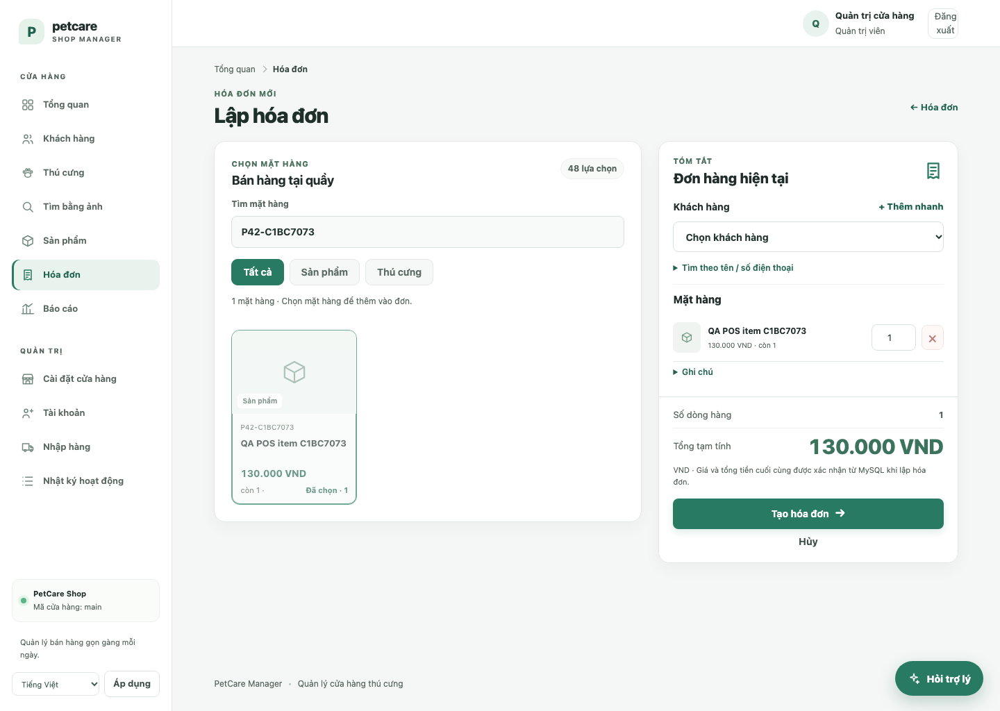

# Phase 4.2 — POS UX và reliability

Ngày: 2026-11-10. Mục tiêu là giữ đường bán hàng ngắn, dễ theo dõi và không làm trôi trạng thái đơn hàng.

## Quyết định UI

POS đã có hai cột catalog/cart trên desktop, search và kind filters, item cards, invoice summary cố định bên phải, giá/tổng được format theo currency, quantity limits, quick customer, note, create invoice và mobile sticky cart preview. Browser QA xác nhận sticky preview hiển thị count + total và nút “Xem đơn hàng” dẫn tới `#pos-order`. Vì pattern hiện có giải quyết việc tìm giỏ trên mobile, không thêm drawer hoặc sticky element thứ hai.

Các cải thiện trong sprint tập trung vào UX thực tế và guardrails: contrast/names shared UI được sửa; actual product/stock/checkout workflow được kiểm trên browser; test keyboard chọn card bằng Enter và focus tự chuyển vào quantity field. Không đổi route, JSON lookup contract, pricing/discount/tax/refund/payment rules hoặc invoice lifecycle.

## Workflow đã chạy

1. Admin mở `/invoices/new`; search mã không tồn tại để kiểm tra empty feedback, sau đó search product đã tạo.
2. Chọn customer và mặt hàng; kiểm tra count/total sticky preview và cart estimate đồng nhất.
3. Trong browser test, dùng bàn phím focus card rồi Enter; focus chuyển vào quantity của dòng mới.
4. Thử quantity vượt stock. Native `rangeOverflow` được phát hiện; test-only tắt native validation để gửi server-side request, service trả lỗi, giữ form và focus/error `Tồn hiện tại`.
5. Sửa quantity về 2, tạo invoice thật và thanh toán; UI success, invoice detail và MySQL stock/ledger nhất quán.
6. Gọi lại `pay_invoice` cho invoice đã trả để xác nhận kết quả `already_paid` và không trừ tồn lần hai.

Browser/POS responsive screenshots: [320px](assets/phase42/after/pos-after-320.png), [390px](assets/phase42/after/pos-after-390.png), [768px](assets/phase42/after/pos-after-768.png), [820px](assets/phase42/after/pos-after-820.png), [1024px](assets/phase42/after/pos-after-1024.png), [1440px](assets/phase42/after/pos-after-1440.png). So với [baseline 320px](assets/phase42/before/pos-320.png) và [baseline 1440px](assets/phase42/before/pos-1440.png), cấu trúc và cách đặt cart vẫn ổn định; ưu tiên test là xác nhận dock luôn nhìn thấy, không làm lệch tổng và không phủ nút/controls quan trọng.

## Kết quả và ranh giới

- 6 viewport widths (320, 390, 768, 820, 1024, 1440): `documentElement.scrollWidth == viewport`, card có thể chọn, estimate và cart summary hiển thị.
- Axe scan empty state mobile, cart mobile và desktop sau khi entrance fade hoàn thành: không có violations trong lượt scan. Scanner ghi “incomplete” cho glyph-only controls, remove-line icon, bottom-nav overlap và vài foreground/background context; xem [chi tiết JSON](assets/phase42/after/axe-results.json).
- Browser diagnostics: zero page errors and failed network requests. Expected `GET /users/` 403 belongs to staff authorization test, not POS.
- Rollback/recovery/error states: quantity rejection tested in browser; payment idempotence and transaction rollback covered in existing MySQL integration suite. Network-loss, browser retry of a duplicate invoice-create POST, real payment gateway and device touch ergonomics remain unverified.
- Screenshot is from a synthetic QA tenant with one search result and one item in cart; it does not claim performance with a full live catalog.
