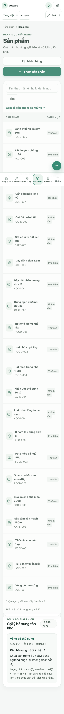
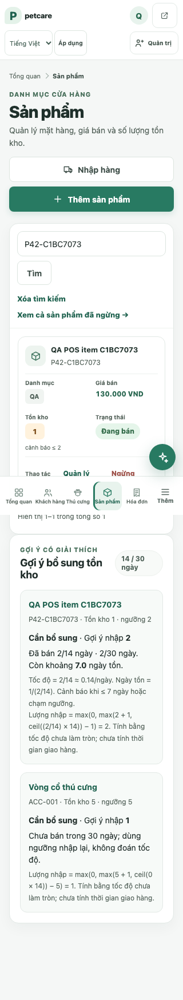

# Phase 4.2 — Product và Inventory UX

Ngày: 2026-11-10. Giữ giao diện server-rendered hiện hữu. Sprint xử lý vấn đề có reproduction rõ và xác nhận phần inventory đã có hoạt động đúng trên browser/MySQL.

## 3C tham khảo

Các nguồn là trang hướng dẫn công khai, không phải phiên đăng nhập hoặc dashboard riêng tư.

| Sản phẩm | Pattern quan sát được | Tùy biến cho Petcare Manager |
|---|---|---|
| [Shopify POS](https://help.shopify.com/en/manual/sell-in-person/shopify-pos) và [theo dõi/điều chỉnh tồn](https://help.shopify.com/en/manual/sell-in-person/shopify-pos/inventory-management/track-and-adjust-inventory) | Catalog, mức tồn và thao tác điều chỉnh gắn với cùng mặt hàng; tồn là dữ liệu thao tác, không chỉ metadata. | Giữ thông tin stock, reorder threshold, thao tác điều chỉnh có lý do và ledger ngay quanh product profile hiện có. Không thêm location/transfer mới. |
| [Square item grid](https://squareup.com/help/us/en/article/8334-set-up-item-grid) | Mặt hàng được duyệt và chọn trực tiếp từ grid trong POS; danh mục hỗ trợ thao tác tại quầy. | POS hiện có grid/card và filters; giữ server lookup, không tạo catalog client-side mới. |
| [Lightspeed item search](https://retail-support.lightspeedhq.com/hc/en-us/articles/228840447-Searching-for-items) và [Sales screen](https://retail-support.lightspeedhq.com/hc/en-us/articles/360035206534-Using-the-Retail-POS-R-Series-Sales-screen) | Search/catalog và sales/cart cùng workflow; trạng thái giao dịch hiện trong màn hình bán hàng. | Giữ search gần product grid và sticky summary; số lượng/tổng vẫn được kiểm từ server trước khi lưu. |

### Copy — Customize — Create

- **Copy:** đặt search, trạng thái hàng và hành động record tại list/profile; đưa stock vào ngữ cảnh mặt hàng.
- **Customize:** tôn trọng cấu trúc table + Flask route + admin-only mutation hiện có. Product list desktop tiếp tục dùng bảng; mobile dùng card có nhãn từng field. Inventory stays in product edit/profile with existing stock ledger and server validation.
- **Create:** biến mobile product list thành card gồm tên/mã, danh mục, giá, tồn + reorder threshold, trạng thái và hành động admin. Đây là cách trình bày riêng của Petcare Manager, không sao chép markup/asset/brand.

## Thay đổi và bằng chứng

Trước sprint, `/products/` ở 320px hiện nhiều cột và cắt mất nội dung quan trọng; khi chạy, cột tồn/trạng thái/CTA không thể xem cùng lúc nếu không kéo ngang. Sau thay đổi, mỗi record được trình bày thành card hai cột có nhãn “Danh mục”, “Giá bán”, “Tồn kho”, “Trạng thái”, cùng action ở hàng cuối. Desktop vẫn giữ table semantics và search/form GET hiện có.

| Màn hình | Before | After |
|---|---|---|
| Product list — 320px |  |  |
| Product list — 1440px | [Ảnh trước](assets/phase42/before/products-list-1440.png) | [Ảnh sau](assets/phase42/after/products-list-after-1440.png) |
| Product create — 1440px | [Ảnh trước](assets/phase42/before/product-create-1440.png) | [Ảnh sau](assets/phase42/after/product-create-after-1440.png) |
| Inventory detail + stock history — 1440px | [Ảnh trước](assets/phase42/before/product-edit-stock-history-1440.png) | [Ảnh sau, có stock correction + sale ledger synthetic](assets/phase42/after/product-edit-stock-history-after-1440.png) |

**Create/edit review:** label, unit VND, integer price note, reorder threshold, initial stock explanation, photo limit, field validation and action hierarchy were opened in Chromium. No unconfirmed form redesign was introduced. **Inventory review:** màn chỉnh tồn hiển thị số tồn hiện tại, signed delta, required reason and recent history (invoice, purchase and refund columns where supported).

## Reproducible inventory workflow

Trên MySQL QA schema, test browser đã thực hiện:

1. Tạo product với stock 2 qua form thật; thử native validation với `stock_qty=-1` và xác nhận `rangeUnderflow`.
2. Nhập stock delta `-3` khi hiện có 2; service từ chối âm tồn, giữ stock=2 và trả lỗi trên UI.
3. Nhập adjustment `+1` cùng lý do; xác nhận UI success và ledger.
4. Đổi giá qua form edit, tìm product ở POS, thêm 2 units và thanh toán invoice.
5. Đối chiếu MySQL: stock cuối=1; movement do invoice là `-2`; replay thanh toán qua service trả `already_paid` và không tạo thêm movement.

Không sửa business rule, tenant scoping, transaction code, ledger schema hoặc quyền. Nghiệp vụ chỉnh stock, return/refund, receiving và negative stock đã được integration suite tiếp tục bao phủ; test mới chỉ tạo dữ liệu trong `_test` schema.

## Giới hạn còn lại

- Product list ở 681px trở lên vẫn là bảng có vùng cuộn ngang; ở effective width 720px (zoom-equivalent) document không overflow nhưng table có nhắc cuộn ngang. Đây là data-table exception cần review bằng browser zoom thật.
- Stock adjustment form và history được chạy ở desktop 1440px; thao tác nhỏ màn hình và touch target của từng control còn cần browser test riêng.
- Search valid/no-match đã chạy qua UI; latency/loading under throttled network và product photo upload không thuộc workflow browser của sprint này.
