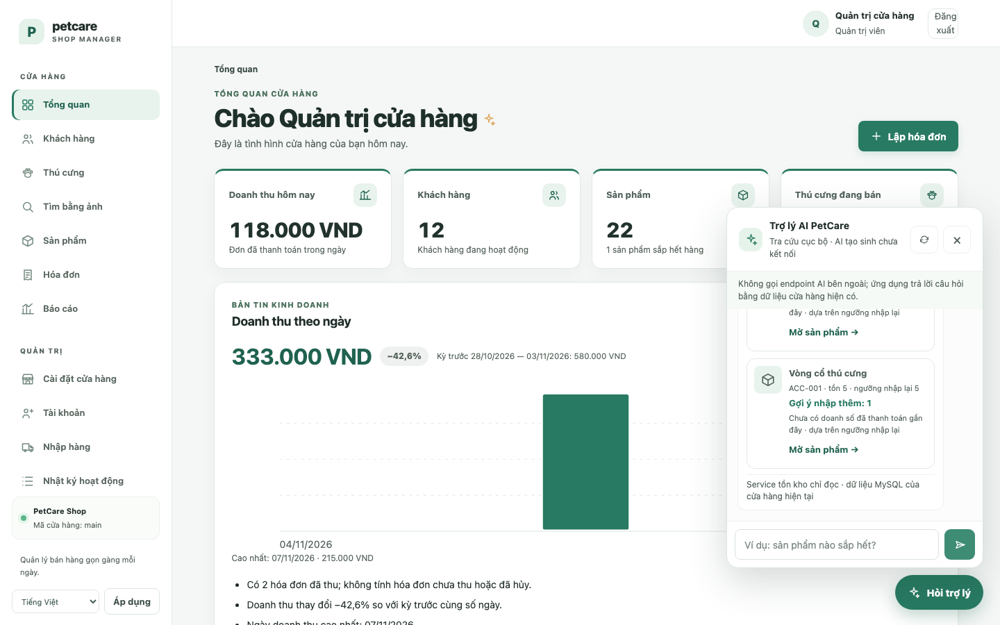
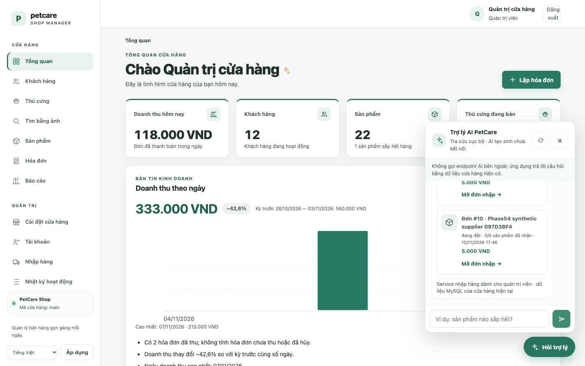
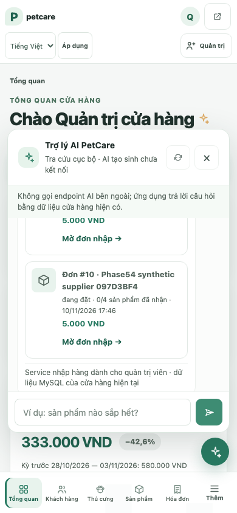

# Phase 5.4 — Assistant UI/UX verification

Chromium được chạy trên Flask và MySQL QA thật; ảnh dưới đây là evidence từ synthetic test fixture. Tôi đã xem ảnh đầu ra trực quan, không suy đoán giao diện chỉ từ source.

## Cải thiện giao diện

- Thêm prompt gợi ý tồn kho và prompt trạng thái đơn nhập cho admin; staff không được gợi ý truy cập purchasing.
- Tồn kho hiện card có tên/mã, stock, reorder level, suggested quantity, estimated days left hoặc lý do dùng reorder level, cùng link product.
- PO hiện status, supplier snapshot, units ordered/received, thời gian tenant-local, tổng tiền và link detail. Không hiển thị note/liên hệ supplier.
- Loading text, reply, empty state, permission restriction và lỗi service có source/status đúng. Lỗi request có nút retry; Enter gửi, Escape đóng và focus về launcher.
- Dữ liệu được dựng bằng DOM text nodes. URL từ API được kiểm allowlist trước khi thành anchor.

## Ảnh chụp

**Inventory insight desktop**

**Purchase order status desktop**

**Purchase order status mobile, viewport 390 px**

## Responsive và accessibility

- Playwright đặt viewport 320, 390, 768 và 1440 px; document width luôn bằng viewport và panel bounds nằm trong viewport.
- Assistant keyboard flow: mở bằng launcher, gửi bằng Enter, đóng bằng Escape và trả focus về launcher. Retry là button native keyboard-accessible.
- Ba axe scan targeted (inventory desktop, purchasing desktop, purchasing mobile): 0 violations. Tổng 40 incomplete node instances cần kiểm thủ công; chưa thực hiện screen-reader, browser zoom 200% hoặc full WCAG review.
- Full browser suite 17/17. Không có failed request hoặc page error; một HTTP/console 403 tại `/users/` của staff là role test expected.

## Giới hạn UI

- Panel và danh sách tin nhắn có scroll; ở ảnh, các card phía trên không hiển thị hết cùng lúc. Người dùng có thể cuộn phần hội thoại để xem các kết quả còn lại.
- Chưa chạy Safari/Firefox, touch device thật, reduce-motion audit riêng, screen reader hoặc zoom browser thật.
- Không có screenshot tiếng Anh trong bộ test này; intent VI/EN được kiểm ở unit tests.
