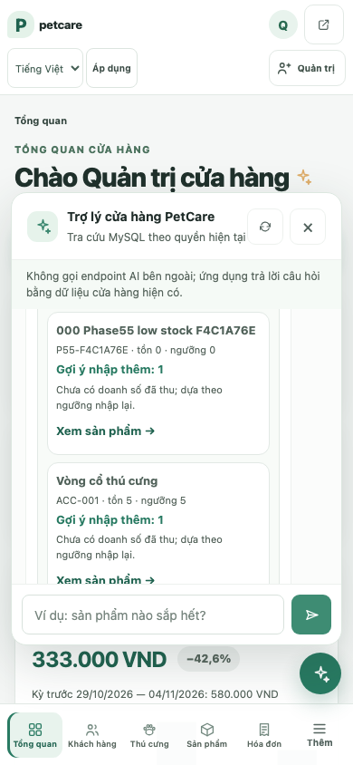
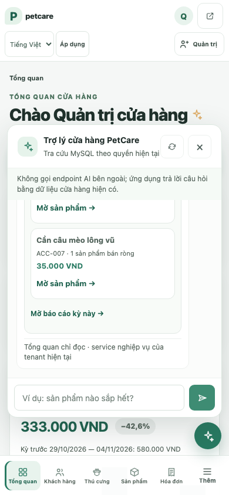

# Phase 5.5 — UX verification

Ngày: 2026-11-11. Thực hiện trên browser Chromium thật, app Flask local và schema MySQL `_test` tmpfs.

## Nhiệm vụ tái lập

Admin cần trả lời ba câu trong cửa hàng:

1. Sản phẩm nào đang đạt quy tắc cảnh báo nhập?
2. Có PO nào đang đặt/chưa nhận đủ không?
3. Sản phẩm nào bán ròng trong bảy ngày gần nhất?

### Trước

Mở assistant, chọn suggestion tồn kho, rồi nhập/gửi riêng câu về PO và top products. Browser quan sát **3 POST `/assistant/chat`**, **6 interaction events** (mở panel, chọn suggestion đầu, hai lần nhập và gửi). Mỗi kết quả xuất hiện riêng trong hội thoại.

### Sau

Mở assistant và chọn suggestion tổng quan. Browser quan sát **1 POST**, **2 interaction events**, ba nhóm dữ liệu cùng một response. Script xác nhận fixture low-stock, PO ordered, sales group, source labels và mỗi CTA.

Đây là phép đếm thao tác theo script cố định, không phải đo giây hoặc nghiên cứu với người dùng thật.

## Quan sát trực quan và điều hướng

- Viewport 390×844: overview render các section trong panel scroll; test kiểm tra document không tràn ngang.
- Breakpoints 320, 390, 768, 1440 px: `documentElement.scrollWidth` bằng viewport; panel nằm trong bounds cả trục ngang và dọc.
- Liên kết product detail, PO detail và report đúng ngày được click; browser nhận các page tương ứng, report response 200.
- Empty/error state từng nhóm hiện rõ; response partial được kiểm trong JavaScript test. Existing JS tests tiếp tục kiểm request loading, `aria-busy`, ngăn gửi trùng và retry sau failure.
- Nội dung business dùng text nodes; link chỉ được render theo allowlist cùng origin.

Ảnh QA thực tế 390×844 (dữ liệu sản phẩm/order QA và seed demo):

## Accessibility và diagnostics

- Hai axe scan ở overview: 0 violations; mỗi lần báo 3 incomplete items cần xem thủ công.
- Existing assistant focus/Enter/Escape/retry tests vẫn chạy trong full JS/Playwright suite.
- Overview E2E không có console error, page exception, failed request hoặc unexpected HTTP response. Full browser suite có một 403 dự kiến khi staff mở `/users/`, cùng một console message do response đó; không có failed request/page exception.
- Screen reader, 200% browser zoom, Safari, Firefox, tactile/mobile device và toàn bộ WCAG chưa kiểm.

## Trạng thái kiểm thử

- Full browser suite: **18/18 PASS, 0 skip**.
- Targeted overview after vertical-bound checks: **1/1 PASS**.
- Axe overview: **0 violations / 3 incomplete mỗi scan**.
- App health/readiness trên QA: `/healthz=200`, `/readyz=200`.
- Các screenshot chỉ dùng dữ liệu test/seed của disposable DB; không chứa dữ liệu production hay credential.

Kết quả test tổng hợp tại [TEST_MATRIX.md](TEST_MATRIX.md); contract tại [API_CONTRACT.md](API_CONTRACT.md).
