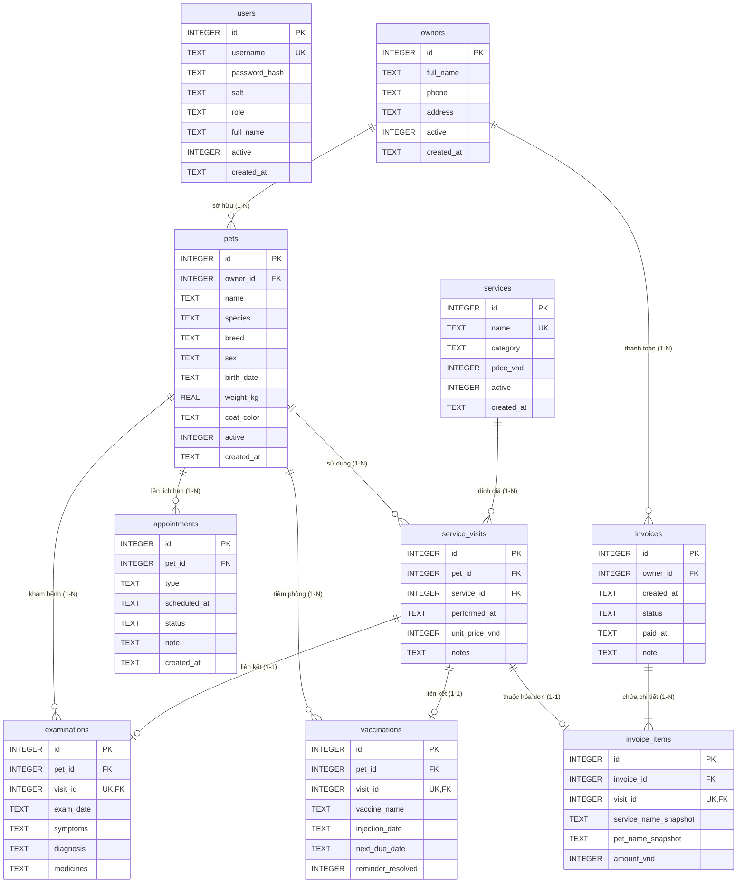

# Sơ đồ Thực thể Quan hệ (ERD - erd.md)

Tài liệu này mô tả cấu trúc 10 bảng cơ sở dữ liệu và các mối quan hệ khóa ngoại trong hệ thống PetCare Manager.

---

## 1. Sơ đồ Quan hệ Thực thể (Mermaid Diagram)

---

## 2. Chi tiết các Ràng buộc Toàn vẹn (Constraints)

1. **Khóa ngoại và Bật Pragma**:
   - Mọi kết nối SQLite đều thực thi `PRAGMA foreign_keys = ON;`.
   - Các bảng `pets`, `service_visits`, `examinations`, `vaccinations`, `appointments`, `invoices`, `invoice_items` đều có ràng buộc `REFERENCES` tới bảng cha tương ứng.
2. **Ràng buộc Tính phí Một lần (`visit_id UNIQUE`)**:
   - `invoice_items.visit_id` được đặt ràng buộc `UNIQUE`.
   - Bất kỳ lượt dịch vụ nào đã tồn tại trong `invoice_items` sẽ bị SQLite từ chối nếu cố tình chèn thêm vào một hóa đơn khác.
3. **Ràng buộc Liên kết Khám & Tiêm**:
   - `examinations.visit_id UNIQUE` và `vaccinations.visit_id UNIQUE` bảo đảm mỗi hồ sơ y tế chỉ gắn liền với một lượt dịch vụ duy nhất.
4. **Bảo toàn Giá lịch sử (Snapshotting)**:
   - Khi dịch vụ thay đổi giá trong `services.price_vnd`, các bản ghi `service_visits.unit_price_vnd` và `invoice_items.amount_vnd` đã lưu trong quá khứ không bị cập nhật theo, giữ đúng nguyên giá trị tại thời điểm thực hiện.
