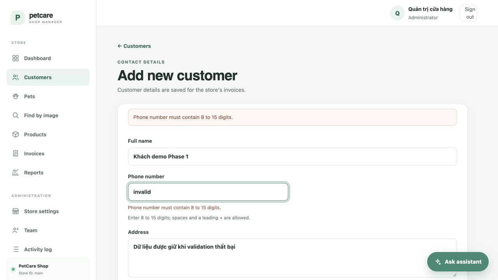
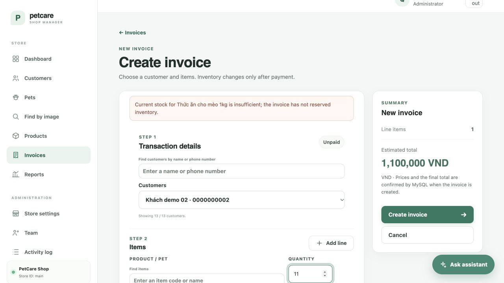

# Báo cáo nghiệm thu Phase 1 — PetCare Manager

Ngày: 24/10/2026. Phạm vi: môi trường local và nghiệp vụ cốt lõi; chưa triển khai Phase 2.

## Kết quả

| Yêu cầu | Kết quả |
|---|---|
| Bảo toàn i18n | So sánh byte-for-byte với bản trước Phase 1: giữ nguyên, bao gồm dòng chưa commit của người dùng |
| Cổng local | 5055 trong Config, run.py, .env, .env.example và hướng dẫn; Compose host mặc định 5055, container vẫn 8000 |
| MySQL | Docker Desktop/Compose MySQL 8.4.11 đã chạy, kết nối được trên loopback |
| Readiness | http://127.0.0.1:5055/readyz trả HTTP 200 với status ready |
| Database dev | Sao lưu mã hóa trước migration cộng thêm; không reset hoặc seed lại |
| Dependency | Khai báo Pillow >=12.0,<14.0; kiểm chứng tương thích 12.3.0, runtime hiện dùng 13.0.0 đã vá advisory; bổ sung Gunicorn còn thiếu |
| Khách hàng | Giữ dữ liệu form thêm/sửa khi lỗi, lỗi theo trường, focus lỗi đầu tiên |
| Hóa đơn | Giữ khách/mặt hàng/ghi chú/tất cả dòng và số lượng; khôi phục lựa chọn ngoài trang lookup đầu bằng service có kiểm tra tenant |
| Trợ lý | Intent độc lập với thời gian; tách bộ lọc giá khỏi từ khóa cho cả thú cưng và sản phẩm; JSON sai kiểu trả 400 |
| Điểm ảnh | Thẻ progress và stylesheet local, không nới CSP |
| Lookup hóa đơn | Tính lại tổng khi reset/cập nhật, hủy request ngay khi gõ, bỏ response cũ, chặn submit khi đang tải, không nhân đôi lựa chọn khôi phục khi tải trang tiếp |

## Kiểm thử

| Nhóm | Đạt | Bỏ qua |
|---|---:|---:|
| Python unit | 137 | 0 |
| Python web | 38 | 0 |
| MySQL integration | 50 | 0 |
| Tổng Python | 225 | 0 |
| JavaScript regression | 9 | 0 |

Toàn suite Python đạt trên cả Pillow 12.3.0 và 13.0.0. Database integration được tạo mới tên `petcare_phase1_*_test`, dùng media riêng, rồi dọn đúng database vừa tạo và quyền scoped sau nghiệm thu. Không dùng SQLite để thay MySQL.

Các kiểm tra bổ sung đạt: pip check, pip-audit theo requirements, pip-audit môi trường thực tế sau cập nhật, Bandit theo baseline của repository, cú pháp Python/Jinja/JavaScript, Compose config và git diff --check.

Audit môi trường cũ phát hiện advisory trong Pillow 12.3.0 và hai gói tooling pip/certifi. Giữ khoảng dependency theo yêu cầu tương thích; nâng môi trường local lên Pillow 13.0.0, pip 26.2.2 và certifi 2026.10.23. Audit cuối không phát hiện lỗ hổng đã biết. Đây là kết quả tại thời điểm kiểm tra, không thay thế nghiệm thu production.

## Kiểm tra trình duyệt với MySQL

- Gửi form khách hàng có số điện thoại sai: tên/địa chỉ giữ nguyên, lỗi cạnh phone, focus đúng phone; không tạo hồ sơ.
- Lập hóa đơn với số lượng 11 trong khi sản phẩm còn 10: server từ chối, giữ khách/mặt hàng/số lượng/ghi chú, focus quantity; không tạo hóa đơn hoặc trừ tồn.
- Đổi từ khóa sau khi đã chọn mặt hàng: lựa chọn được xóa và tổng về 0 ngay; danh sách không khớp có thông báo rõ.
- “Hôm nay còn mèo nào?” trả về 5 mèo trên database dev, không chuyển sang doanh thu.
- “Tìm mèo lông trắng dưới 3 triệu” trả Mây, Mực, Sữa với giá tương ứng 2,7 / 2,5 / 2,2 triệu trên database dev hiện tại.

Ảnh bằng chứng:





## Quy ước parser và giới hạn

- “Dưới/trên” dùng so sánh nghiêm ngặt; “tối đa/tối thiểu/từ…đến…” bao gồm biên.
- Khoảng “từ 2 đến 3 triệu” dùng chung đơn vị triệu cho hai đầu.
- “Khoảng N” dùng N ±10%, đã ghi trong hướng dẫn.
- Trợ lý vẫn là parser theo quy tắc và có giới hạn bản xem trước danh mục; không mở rộng sang truy vấn toàn danh mục hay card AI của Phase 3.
- Nghiệm thu này bao gồm web/MySQL local. Không bật gửi email, không gọi endpoint AI bên ngoài, không triển khai production.

## Chạy lại

```sh
python -m pip install -r requirements.txt
docker compose up -d mysql
python run.py
```

Ứng dụng: http://127.0.0.1:5055. Trước khi chạy integration, tạo database mới có hậu tố `_test`, cấp quyền trên đúng database rồi đặt `PETCARE_TEST_DB_NAME` và cấu hình DB tương ứng; tuyệt đối không trỏ fixture vào database dev.

```sh
python -m unittest discover -s tests -v
node --test tests/js/*.test.cjs
```

Thay đổi source được giữ tại working tree để review, chưa commit/push. Phase 1 hoàn tất; dừng trước Phase 2.
