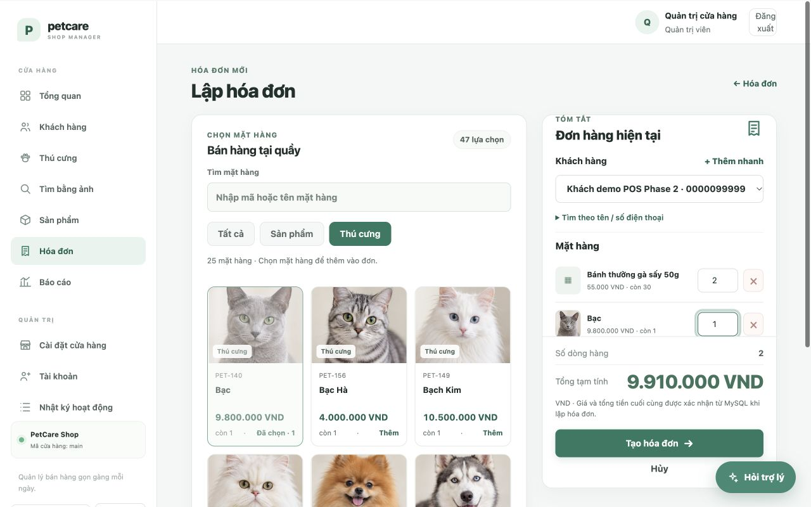

# Kết quả Phase 2 — Chuẩn hóa UI/UX và dữ liệu demo

Ngày nghiệm thu: **25/10/2026**. Dự án: `petcare-manager`. Phạm vi hoàn tất: Phase 2; chưa chuyển sang Phase 3.

## Thay đổi đã hoàn thiện

- **Hệ thống giao diện:** hợp nhất selector và các nhóm breakpoint 1200/980/680/420 px, dùng system font không phụ thuộc mạng; giữ màu chủ đạo `#287A62`. Chuẩn hóa spacing, badge trạng thái, toast có nút đóng, empty state, focus và reduced motion. Menu quản trị trên mobile có đủ đường dẫn cài đặt/thành viên/nhật ký.
- **POS:** hai vùng catalog và tóm tắt đơn; chọn trực tiếp thẻ có ảnh (hoặc biểu tượng khi chưa có ảnh), mã, giá và tồn. Tìm kiếm debounce, phân trang, bỏ response cũ, skeleton và trạng thái lỗi. Giỏ hàng giữ qua đổi từ khóa/bộ lọc; sản phẩm tăng đến tồn, thú cưng là từng cá thể với số lượng 1. Tổng tiền dùng định dạng theo currency; backend tiếp tục kiểm tra và tính giá bằng Decimal.
- **Khách hàng:** modal thêm nhanh có CSRF, quyền và validation từ service hiện có; hiển thị lỗi từng trường, chọn khách vừa tạo ngay và giữ nguyên giỏ hàng. Esc đóng modal, trả focus phù hợp.
- **Tương tác:** khóa gửi lặp/trạng thái bận cho lookup, chat, tìm ảnh và export; Enter gửi chat, Esc đóng trợ lý, phản hồi đến sau không giành lại focus. Export dừng polling khi hoàn tất hoặc thất bại.
- **Ảnh:** bổ sung fallback hiển thị khi file không tải được. Sửa lỗi cạn MySQL pool khi trình duyệt tải nhiều ảnh riêng tư đồng thời: chờ slot tối đa 3 giây, giữ nguyên giới hạn kết nối; lỗi DB khác không bị retry.
- **Demo:** chạy lại seed cập nhật ngày tương đối của đúng 7 hóa đơn mẫu cùng stock movement, bỏ qua hóa đơn mẫu đã hủy, không thanh toán/trừ kho lại. Bổ sung ảnh mẫu thiếu hoặc file đã mất, giữ ảnh hợp lệ và thông tin đã chỉnh sửa. Dashboard có khối doanh thu 7 ngày qua và liên kết báo cáo.
- **Tài liệu:** README, hướng dẫn sử dụng/demo, trạng thái, báo cáo/slide, changelog và kết quả test đã đồng bộ schema **20 bảng**, số liệu seed và thao tác POS.

## Dữ liệu thực tế

| Hạng mục | Seed chuẩn trên DB mới | Dev sau nghiệm thu |
|---|---:|---:|
| Khách hàng | 12 | 14 (giữ thêm dữ liệu cũ) |
| Sản phẩm | 22 | 22 |
| Thú cưng | 74 | 74 |
| Ảnh thú cưng | 68 | 68 |
| Hóa đơn demo đã thanh toán | 7 | 7 |
| Bảng MySQL | 20 | 20 |

Đã backup dev bằng bản dump mã hóa trước khi seed. Tổng tồn sản phẩm **501 → 501** qua lần làm mới; không reset database dev. Hóa đơn nghiệp vụ ngoài marker demo giữ nguyên. Ảnh sản phẩm không được seed sẵn, có thể tải từ form admin. Seed không đưa thú cưng đã bán trở lại bán.

## Kiểm thử và bằng chứng

| Bộ kiểm | Kết quả |
|---|---:|
| Python unit | 139/139 |
| Flask web | 44/44 |
| MySQL integration thật, DB `_test` riêng | 53/53 |
| **Tổng Python** | **236/236, không skip** |
| JavaScript regression | **15/15** |
| Python/Jinja/JS syntax, diff, Compose | Đạt |
| Bandit theo baseline đã có | Đạt, không finding mới |
| `/readyz` cổng 5055 | HTTP 200 |

Regression mới kiểm tra POS/JSON ảnh/Decimal, thêm nhanh khách có CSRF và quyền Staff, giữ giỏ hàng/chống gửi lặp, abort/debounce, focus/Esc, export polling, seed ngày/ảnh/tồn và 12 request ảnh đồng thời khi pool chỉ có 2 kết nối. Database test tạm cùng grant riêng đã được dọn.

Chrome kiểm tra 1280×800, 768×1024, 390×844: không tràn ngang; ảnh đang hiển thị tải thành công. Trên desktop/tablet, tổng và nút tạo đơn ở vùng tóm tắt; mobile xếp catalog và đơn hàng theo chiều dọc. Luồng thêm khách trong DB test giữ đúng 2 sản phẩm và 1 thú cưng, tổng 9.910.000 VND. Không tạo/thanh toán hóa đơn thử trên dev trong Phase 2.

`petcare.i18n` khớp byte-for-byte với snapshot trước Phase 1, giữ nguyên phần việc chưa commit của người dùng. Các thay đổi Phase 1 và phần việc chưa commit khác được giữ lại; chưa commit/push.

## Chuẩn bị buổi demo

Trong venv của dự án, trên database `_dev`:

```sh
python -m petcare.database.seed
python run.py
```

Nếu server đang chạy, chỉ cần chạy seed rồi tải lại dashboard. Mở [ứng dụng local](http://127.0.0.1:5055). Chế độ trợ lý local/tìm ảnh local vẫn dùng được khi chưa cấu hình AI endpoint; Phase 3 sẽ xử lý nâng cấp AI/automation đã duyệt.

## Ảnh nghiệm thu



[POS tablet](phase2-pos-tablet.png) · [POS mobile](phase2-pos-mobile.png) · [Giỏ hàng mobile](phase2-pos-mobile-order.png) · [Dashboard dev](phase2-dashboard.png)
