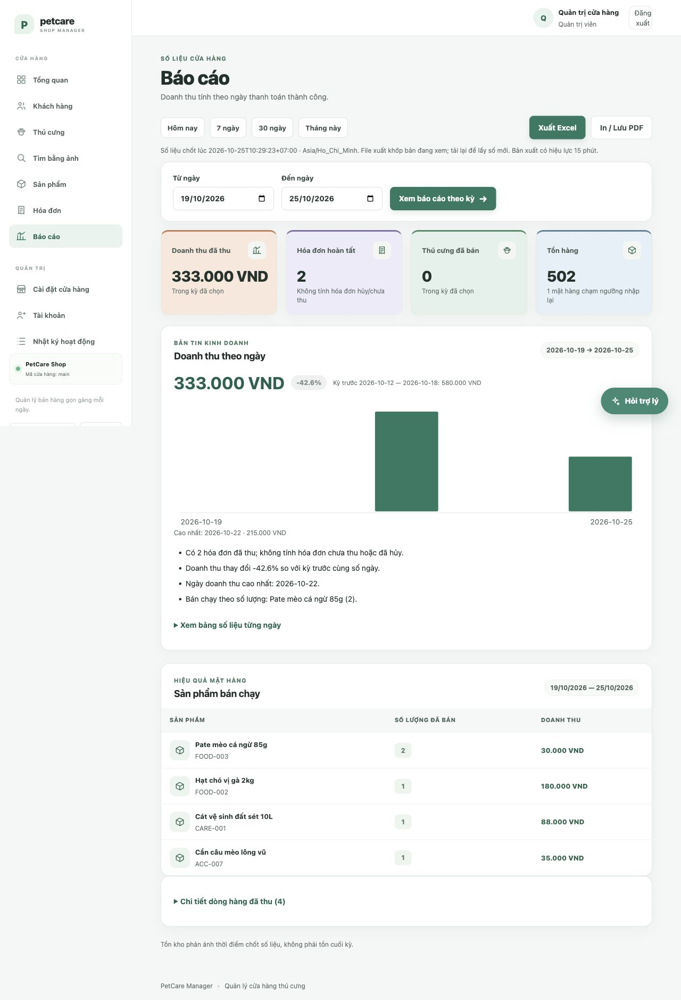

# Kết quả Phase 3 — AI và Automation

Nghiệm thu: **25/10/2026**. Hoàn tất **3.1, 3.2, 3.3 và 3.4** trên kiến trúc Flask/Jinja/JavaScript/MySQL hiện có. Chưa chuyển sang Phase 4.

## Kết quả triển khai

| Mục | Kết quả |
|---|---|
| **3.1 Trợ lý thao tác được** | Parser biên dịch bộ lọc thành SQL tham số hóa trên toàn danh mục đang bán; COUNT chính xác, LIMIT 12 chỉ giới hạn card. Card có ảnh/biểu tượng, giá, tồn/trạng thái và mở đúng hồ sơ. Local/LLM dùng cùng kết quả MySQL; provider lỗi vẫn trả card local. |
| **3.2 Restock có giải thích** | Paid 14/30 ngày → tốc độ bán → ngày tồn → lượng bổ sung đủ kế hoạch 14 ngày. Cảnh báo dưới 7 ngày hoặc Tiếpchạm ngưỡng. Chưa có lịch sử dùng reorder_level; ceil số nguyên tránh nhập dư do phân số. Dashboard/Sản phẩm/hồ sơ sản phẩm có công thức; không tự điều chỉnh tồn. |
| **3.3 Bản tin và xuất báo cáo** | Biểu đồ SVG theo ngày, kỳ nhanh, so sánh kỳ trước cùng số ngày, bản tin Python. Nền bằng 0 không tạo tỷ lệ giả. Excel bốn sheet lấy từ snapshot ký theo user/tenant, TTL 15 phút, có CSRF; vẫn khớp màn hình nếu DB thay đổi sau render. In/PDF gọn, tự mở chi tiết và khôi phục trạng thái sau in. |
| **3.4 Tìm ảnh và thuộc tính** | Lọc loài/trạng thái trước xếp hạng; điểm màu/cấu trúc/thuộc tính và nhãn lý do. Upload gợi ý tự động, chỉ áp dụng vào trường trống khi người dùng bấm duyệt. Local chỉ ước lượng màu; Vision lỗi/JSON hỏng về local. |

Dependency mới của ứng dụng: **XlsxWriter**. Không thêm schema, worker hoặc hạ tầng mới. Module `petcare.i18n` khớp byte-for-byte với snapshot trước Phase 1; giữ nguyên phần việc chưa commit. Không commit/push trong lượt này.

## Kiểm thử

| Bộ kiểm | Kết quả |
|---|---:|
| Python unit | 162/162 |
| Flask web | 53/53 |
| MySQL integration thật trên `_test` riêng | 56/56 |
| **Tổng Python** | **271/271, không skip** |
| JavaScript regression | **19/19** |
| Python/Jinja/JS syntax, Compose, pip check, diff | Đạt |
| Bandit theo baseline, dependency audit requirements | Đạt |
| `/readyz` tại cổng 5055 | HTTP 200 |

Ca đáng chú ý: tìm pet/product ngoài preview 250/100 bản ghi; cô lập tenant; cùng card trong local/LLM/lỗi mạng; paid-only restock và ceil chính xác; ngày địa phương/DST; tổng màn hình/ngày/chi tiết/Excel; DB đổi sau render; token sai user/tenant/hết hạn; formula injection và số tiền lớn; report vượt giới hạn có đường phục hồi; lọc ảnh/gợi ý upload/quota; giữ dữ liệu nhập tay; chống gửi lặp/abort và trạng thái trước/sau in.

Local đã chạy thực tế trên IAB/Chrome. LLM/Vision được kiểm tra bằng phản hồi và lỗi mô phỏng; **chưa nghiệm thu provider trực tuyến thật** khi không có endpoint cấu hình.

## Nghiệm thu giao diện và file

- Card có ảnh/giá/trạng thái, bấm mở đúng hồ sơ Mây.
- Upload ảnh mẫu tạo gợi ý local; áp dụng giữ nguyên loài đã nhập tay.
- Báo cáo desktop 1280 px và mobile 390×844 không tràn ngang; sidebar desktop cuộn được để không khuất điều khiển cuối.
- Excel tải thành công bằng nút trong ứng dụng, đã import/render kiểm tra đủ 4 sheet.
- PDF được lưu bằng nút In/Lưu PDF qua Chrome: **2 trang**, đầy đủ bảng ngày và chi tiết, bỏ navigation/trợ lý/nút xuất. Đã render kiểm tra cả hai trang; trạng thái các bảng đóng được khôi phục sau in.
- Bộ báo cáo mẫu dưới đây dùng dữ liệu tổng hợp trên DB QA riêng: **333.000 VND**, khớp màn hình/Excel/PDF. Đây không phải bản chụp dữ liệu dev hiện tại.

[Excel mẫu](phase3-demo-report.xlsx) · [PDF mẫu](phase3-demo-report.pdf)

[Card trợ lý](phase3-assistant-cards.png) · [Gợi ý thuộc tính](phase3-attribute-suggestions.png) · [Báo cáo mobile](phase3-report-mobile.png)

## Trạng thái bàn giao

Dev giữ **20 bảng, 14 khách, 22 sản phẩm, 74 thú cưng, 68 ảnh và tổng tồn sản phẩm 501**. Không seed/migrate/reset dev trong Phase 3. Database `_test` tạm và grant scoped đã được dọn; tab và viewport thử nghiệm đã dọn. App mới đang chạy tại [localhost:5055](http://127.0.0.1:5055).

Báo cáo giới hạn tối đa **366 ngày/5.000 dòng hàng** mỗi kỳ; vượt giới hạn yêu cầu chọn kỳ ngắn hơn, không cắt chi tiết. Tồn kho là lúc chốt, không phải tồn cuối kỳ. Snapshot Excel hết hạn sau 15 phút thì tải lại trang để xuất. Gợi ý nhập kho chưa tính lead time nhà cung cấp/mùa vụ; chỉ dùng hỗ trợ quyết định.

Trên máy khác, cài lại `python -m pip install -r requirements.txt` rồi chạy `python run.py`. Hướng dẫn chi tiết và công thức nằm trong `docs/phase3_ai_automation.md`; kịch bản thao tác đã bổ sung trong `docs/demo_scenarios.md`.
