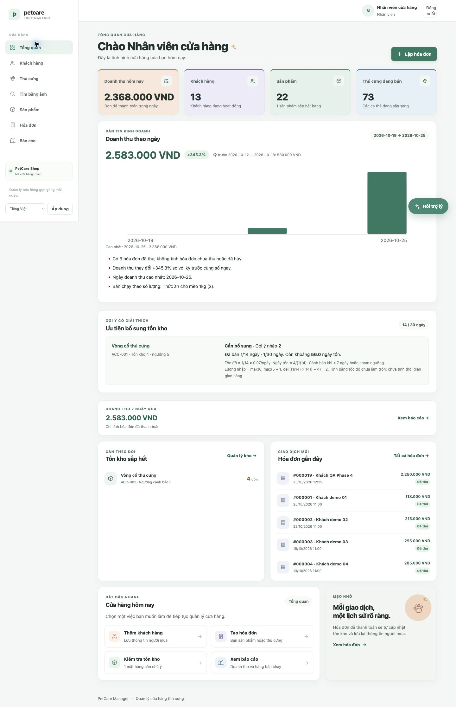

# Phase 4 — hoàn tất ngày 25/10/2026

Đã hoàn thành kiểm thử tổng thể, lệnh chuẩn bị demo và tài liệu thuyết trình. Không triển khai thêm hạ tầng hoặc chuyển sang công việc ngoài phạm vi đồ án.

| Hạng mục | Kết quả |
|---|---|
| Unit / Web / MySQL integration | **171 + 55 + 57 = 283/283**, không fail/error/skip; 32,014 giây |
| JavaScript | **19/19** |
| Demo preflight | **0,760 / 0,671 giây** đo ngoài process; làm mới đúng 7 hóa đơn mẫu |
| MySQL lỗi | Exit 1, mã 2003 rõ ràng, **0,754 giây** |
| Excel so với màn hình QA | **2.583.000 VND**, 3 đơn, 1 pet, tồn 499; khớp workbook 4 sheet |
| Dev sau kiểm tra | **20 bảng, 14 khách, 22 sản phẩm, 74 pet, 68 ảnh, tổng tồn 501**; `/readyz` 5055 HTTP 200 |

Đã kiểm thực tế Admin/Staff, giữ dữ liệu và focus khi validation, quick customer không mất giỏ, đơn hỗn hợp 2.250.000 VND, trạng thái kho/thú cưng trước và sau thu, trợ lý Việt, gợi ý nhập kho, tìm ảnh Mây và tải Excel. Chống thanh toán lặp và tranh chấp tồn cuối chạy bằng test MySQL thật. Sửa thêm lỗi thông báo validation bị bó trong ô số lượng của POS.

Dùng hai terminal cùng venv/.env tại thư mục dự án:

```sh
# Terminal 1:
python run.py
# Terminal 2, ngay trước bảo vệ:
python run.py prepare-demo
```

Chỉ bắt đầu khi preflight báo **SẴN SÀNG** (exit 0). Lệnh kiểm đúng server/database, quyền, tồn và ảnh local; ngân sách worker 4,7 giây, lỗi/quá hạn trả exit 1. Nạp seed/ảnh ban đầu thực hiện trước buổi bảo vệ. Không tự thanh toán lại hoặc thay tồn/trạng thái thú cưng/mật khẩu. Hai database QA/test và scoped grant đã dọn, server QA đã dừng; app chính tiếp tục chạy ở cổng 5055.

- [Kịch bản bảo vệ 8 phút](../../DEMO_SCRIPT.md)
- [Ma trận và bằng chứng nghiệm thu chi tiết](phase4-acceptance.md)
- [Log Python](phase4-python-final.log), [log JavaScript](phase4-js-final.log), [kết quả preflight](phase4-preflight-dev.json)
- [POS giữ dữ liệu khi lỗi](phase4-invoice-validation.png), [hóa đơn đã thu](phase4-sale-paid.png), [báo cáo](phase4-report-screen.png), [tìm ảnh](phase4-image-search.png)



`petcare.i18n` giữ nguyên từng byte so với snapshot trước Phase 1; thay đổi chưa commit được bảo toàn. Không commit/push. AI local đã kiểm thực tế; provider LLM/Vision online chỉ được kiểm bằng mô phỏng vì chưa cấu hình endpoint thật. PDF trình duyệt đã có bằng chứng Phase 3, lượt này chạy lại regression trước/sau in. Dependency audit, pip check, syntax, Compose, git diff và Bandit theo baseline đều đạt; baseline security cũ vẫn được giữ.
